# Preamble

In March 2024, I wrote a [blog post]({{site.baseurl}}/docs/Radio/Sat reception journey.html) about the journey I took while falling down the rabbit hole that is satellite reception. I have considered rewriting it on several occasions, as a lot of people were curious about what I've been up to since then with this hobby. But, the longer I waited, the more content there was to write about and the more I felt like it wasn't worth the time and effort to write an update. So it sat there, untouched, for two and a half years.

Now, as of writing this sentence, we are in October 2026. I noticed that my 3-year satrx anniversary was just last week - given this milestone, I felt like it would be appropriate to give this a shot now.

This page will start where the previous one left off, 02/2024, and go up to today (10/2026). The goal is to describe what I experimented with and achieved for bookkeeping, and to feed your curiosity if you want to see what two and a half years of satrx involved. 


*My first image received from a satellite - NOAA 18 received on 12/10/2023 using a V-dipole nailed to a wooden board that I held hanging outside my balcony. Decoded using WxToImg. 60% quality lossy JPEG compression applied.*

Given the huge timescale, I will say that this will definitely be the most expansive article on my blog (as of now) - I've gone from barely doing geostationary L-band to doing X-band! If end up reading this, you're either really bored or really curious. In either case, I hope you have a fun time going through it! I tried my best to keep it at least *SOMEWHAT* entertaining to read.

For the sake of consistency and remaining at least somewhat legible, I will try to follow the format:

```md
# What happened
> Start date - End date if applicable
```

Additionally, a DD/MM/YYYY format will be used within this article.


A table of significant contents can be found below for your convenience.

# Significant events
TODO:FIJNISH
- 12/2025 - [First X-band]

# 2024

Having started with this hobby in 10/2023, I really didn't know much yet in 2024. This made the year very experimental - I was trying out whatever came to my mind rather spontaneously.

## Start of my Satellite reception guide

27/12/2023-24/2/2024

Having gotten a lot of info from several sources (primarily via word of mouth), I originally started writing a collection of all knowledge I have learned in the form of a sort of 'guide' all the way back in 27/12/2023. A (heavily WIP) copy is still available [here](https://github.com/Meti172/blog-page/commit/b17032ddc9d811d60d9c239556420e5ce03cbd07). As the preamble suggests, I didn't think I'd be into this hobby as much as I ended up being. So, I wrote it as something that I might come back to later or share with my close friends. 

> Take anything in this version with a huge grain of salt, I didn't know basically anything back then!

> Since it included a lot of overlap with Lego's guides, I made sure to ask him for his permission, include a notice in the VHF guide to this day.

Over time, I felt like I added a lot of things which could help others in receiving these satellites which aren't included in other guides such as: different antenna types, layman questions for people who haven't dealt with SDR before, geostationary satellite information etc. 

So, in February, I finally renamed it from being just a 'Radio knowledge collection' to a proper 'Beginner's guide to weather satellite reception'.ltex

Originally it meant to be all-encompassing for both VHF and L bands, but I later realized it made more sense to split these in two; particularly because of the vastly different requirements L-band has. The now long outdated version is still viewable [here](https://github.com/Meti172/blog-page/blob/12d8a605fe5084f712a7c17f0d8d8cca78401563/Beginners%20guide%20to%20satellite%20reception.md).

The guide became something I worked on in my free time since then.

## First HRIT images

27/2/2024

After being able to make my helix half-decently and actually putting it in the focal point, I managed to get enough of an SNR to get my first HRIT imagery! The first reception was very borderline as I was getting it at 3.5 dB, just above the 3 dB hard minimum for this transmission. However, after marginal improvements by changing my location and helix spacing, I got it up to 4 dB, which was enough for a clean imagery!

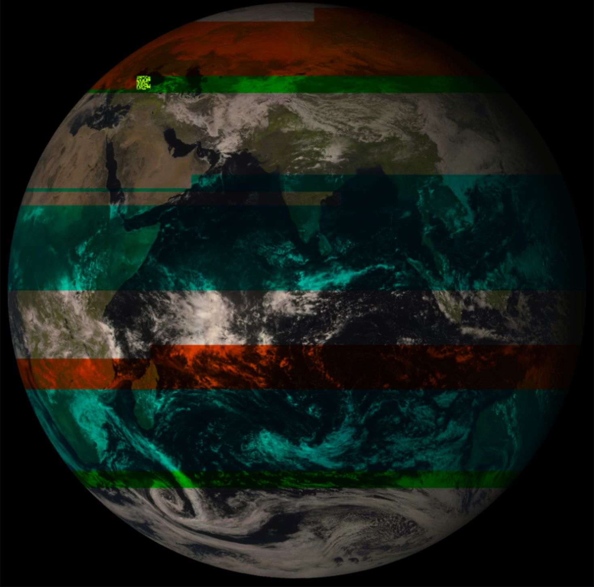
*The first HRIT image I received from Elektro-L3 on 27/2/2024 at 09:12Z with a 130 cm dish and SawBird GOES+. 80% quality JPEG compression applied.*

After managing to get clean imagery a couple of days later, I focused on some other things. Some notable things which don't really deserve their own heading here:
- 18/5/2024 - I switched from using GitHub's markdown renderer GitHub pages, paired with the Just the docs theme that I worked with before.
- 18/1/2025 - L-band was separated from the VHF guide to make it more accessible

## Meteor M2-4 launch

29/02/2024

This was my first experience with watching a satellite launch along with the related commissioning. Lucky for me, Russians were especially nimble with M2-4 - it was transmitting just a day after launch!

Because of TLE uncertainty, the community didn't really know where it was, so we just pointed at the preliminary TLEs and prayed to see a signal. For me, I felt like it would be very cool to receive it for the first time, so I obviously gave it a shot!

On March 1st at 12:00Z, I was tracking a preliminary TLE which was placed roughly 5 minutes after M2-2. I pointed my dish wildly in the whole range where I should have been able to see it, but I ended up not seeing anything there. Not wanting to waste the setup already being there, I waited for M2-2 to pop up and started tracking it instead. 

For some reason, I started seeing the carrier about 30 seconds earlier than I expected - I thought this was strange but didn't pay it that much attention at first, as my TLEs were frequently off by about that much. After about a minute though, a second carrier appeared. One of these was M2-2 and the other was M2-4!

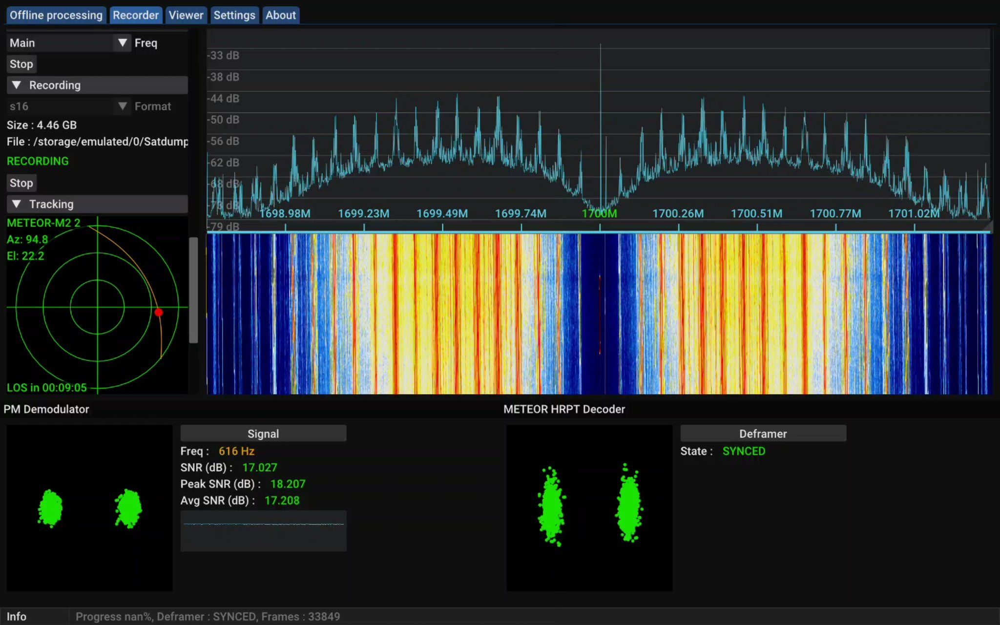 <br>
*SatDump decoding Meteor M2-4 HRPT on 1/3/2024 at roughly 12:04Z. Notice how there is a second carrier just below the strong one - that is M2-2 being behind M2-4 showing itself as it being at a lower frequency because of doppler shift!*

I had a 50/50 shot of receiving either M2-4 or M2-2 given that the signals look identical, I ended up choosing right though - I tracked M2-4 all the way until the end. **This was the first confirmed Meteor M2-4 reception on HRPT!**

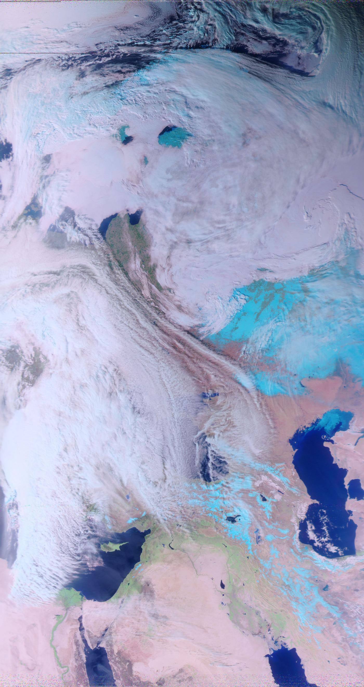
*First confirmed L-band Meteor M2-4 reception on 1/3/2024 at 12:00Z by yours truly from Eastern Slovakia. Processed using SatDump with the `AVHRR 3a21 False Color` preset. 80% quality JPEG compression applied. Resized to 50%.*

As a fun side note, the constellation was very funky when the two satellites got close to one another - see [here](https://x.com/Meti172172/status/1763638058358866076)


## Cantenna experiments and S-VISSR

Mid-03/2024

With M2-4 having gone silent because of commissioning works, I switched my focus back to geostationary satellites. More specifically, this time I started focusing on **linear** satellites - FengYun-2H and EWS-G2 (GOES-15). I was told that there wasn't really a point in receiving these without a linear feed because they are so weak and using a circular feed would take away too much SNR. So, I made this beauty:

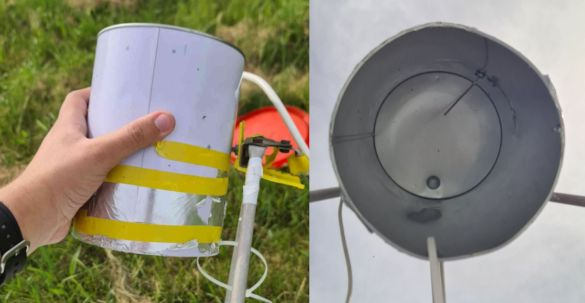

This was a simple piggy bank with an SMA probe on one side. I swear by cantennas to this day as, in my experience, they have been the most reliable and easy to maintain linear feeds.

Ignoring the focal point suggestions (left side is how it is supposed to be, the second picture was my original setup where it was mounted to the bottom of the bracket) and not knowing that I have to skew the feed to receive things properly, I received everything at a very poor SNR. At that time the EWS-G2 decoder was unable to work with the 4 dB I had on GVAR, so I switched to S-VISSR instead. It yielded me roughly 6 dB, which was enough to get clean imagery when paired with [Foxik's S-VISSR corrector](https://github.com/Foxiks/fengyun2-svissr-corrector).

Not having a stand, I instead leaned the dish up against a tree and sat next to it for the whole duration of the image in order to keep it stable. I decided I only wanted the first images of the hour as they were full-disks. So, I sat next to the dish every hour from XX:00 through XX:30, after which I went inside for 30 minutes. I did this for 7 consecutive time slots. *Talk about dedicatoin!*

Having the hindsight of 2026, I now know that skewing the dish properly and having the cantenna in the correct spot would have given me roughly 12 dB. D'oh!


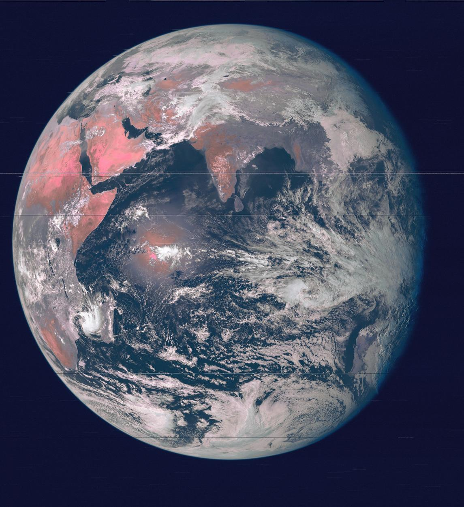 <br>
*FengYun-2H received on 10/3/2024 at 09:25Z using a 130 cm dish and unskewed cantenna. SNR was roughly 7 dB at its peak. Correction used, 80% quality JPEG-compression applied, resized to 12.5%.*


## FengYun-3C

03/2024

Having had my fill of S-VISSR, I wanted to give FengYun-3C a shot. Back then, it still transmitted true color imagery on L-band while in sight of China. This gave me LOS for about 5 minutes at a time to get some fancy imagery off of it!

I had several issues while trying to get it though:
- An RTLSDR didn't have a high enough sampling rate to decode it, so I couldn't get it until I got the HackRF
- I kept using too high sampling rates on my Android tablet, causing sample drops making the imagery unusable. At least it got me a good stock image for my guide (: (See L-band guide and check common issues)
- I kept forgetting about the passes or failed to set up in time before the transmission went dark

I originally tried to receive it in early March, but kept failing because of sample drops. I gave it another try later, and finally succeeded in getting a clean image all the way until it stopped transmitting! It was surreal seeing true color imagery, having been used to the (comparatively) ugly false color composites back then. It was even more surreal thinking about how I got them myself - the only other way was X-band which felt like absolute unobtanium back then!

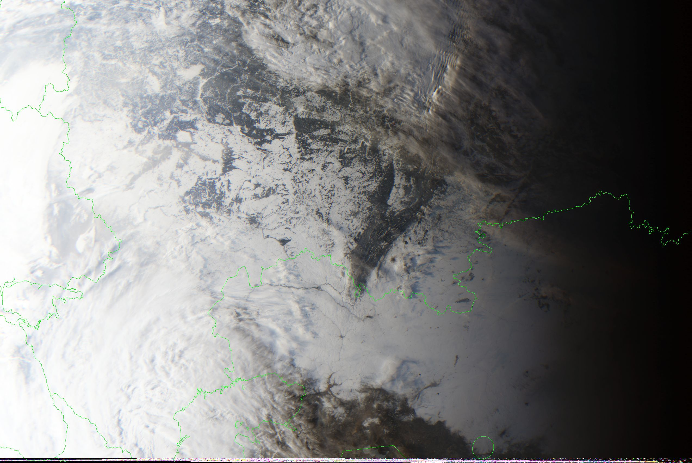
*My first good FengYun-3C AHRPT reception, received on 16/03/2024 at 13:16Z from Eastern Slovakia with a 130 cm dish, SawBird GOES+ and a HackRF. Processed using SatDump with the `197` (True Color) preset. 80% quality JPEG-compression applied, border overlay applied.*

## Lizard intermission

28/03/2024

I was receiving some FengYun-2H S-VISSR at this day with my niece, between time slots I was pacing around the dish when I spotted and caught a couple lizards.

This has no real relation to satellite reception. I just thought it was cool.

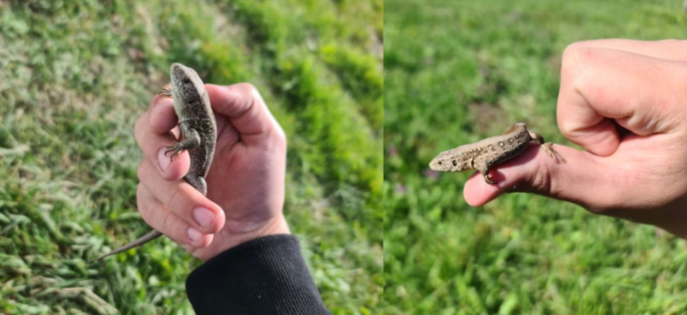
*Two incredibly chilled out lizards I caught while waiting for the next FY-2H slot.*

## S-band  part one

02/2024 - 04/2024 

As the fact of this being spread into parts suggests, my S-band experience is a treacherous story. I briefly mentioned it in the previous blog post, but I will elaborate on it here. I've always wanted to receive S-band, as I was enamored by the sun imaging satellites. Additionally, it would FINALLY allow me to get good NOAA-15 HRPT (as the L-band antenna was damaged).

The most common solution everyone used to take was modifying an old [MMDS](https://en.wikipedia.org/wiki/Multichannel_multipoint_distribution_service) receiver to have an N connector instead of its stock antenna, then screwing it onto a helix. Since MMDS is not really used nowadays as better formats exist and the frequency allocations were bought out by telecommunication companies for cell use, these are relatively hard to come by nowadays. Because of this, a lot of people settle on Chinese 'Bote' brand downconverters, which perform very poorly.

In the previous page, I described buying just that - a Chinese clone. To my credit, it was sourced locally, and I didn't know these sucked back then!

> Note: While writing this section, I actually felt like I was losing my mind. It was so long in the past that I genuinely have no recollection of what possibly could have happened to this MMDS. I might have thrown it out, I might have shoved it into the back of a random closet, or it might have spontaneously combusted. I GENUINELY HAVE NO IDEA AND IT IS DRIVING ME NUTS!!!


After spending some time troubleshooting it and getting next to no results, I caved and purchased a second one which was from a local, reputable company. However, it was made for a different frequency range: 2.5-2.6 GHz.


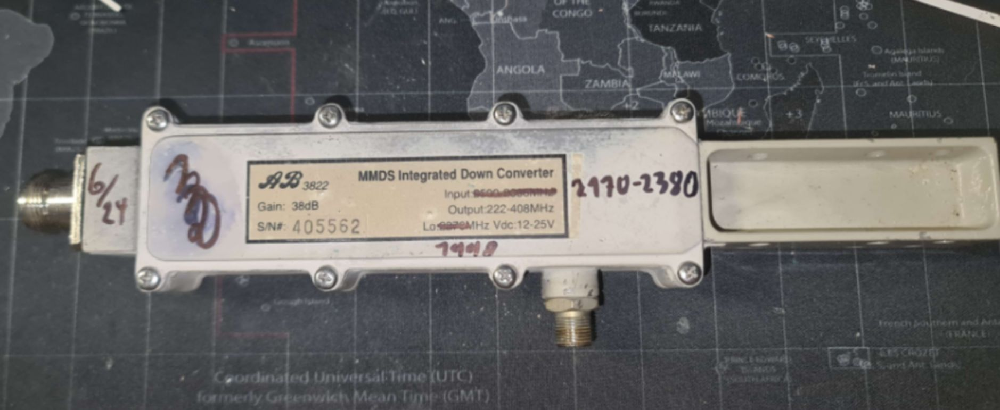 <br>
*The markings are after the mod. They will be explained later.*

There were two problems I had to solve before using the MMDS:

**1. The original filter completely cut off the 2.2 GHz satellite band**

The solution was to scrape the original hairpin filter off and instead put a custom one there. I snagged a BFCN 2275+ from Minicircuits for this.
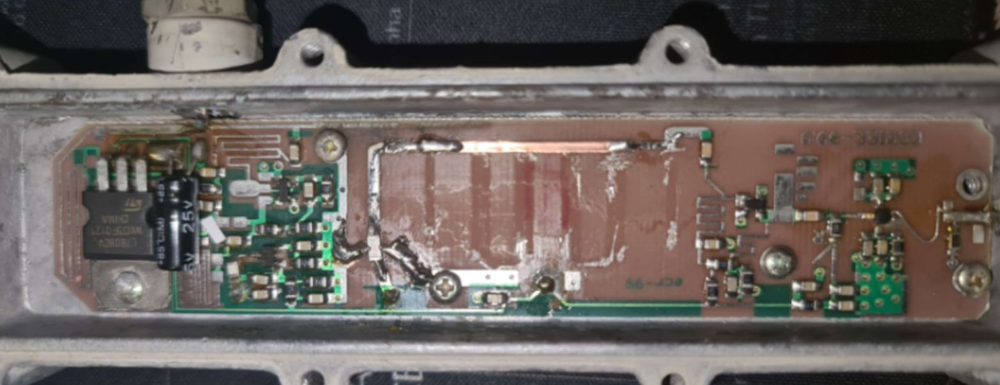 <br>
*The inside of my MMDS, you can see the etched-off traces and the newly soldered filter on the center-left side. The right side is the input.*

**2. The downconversion frequency was too high**

Originally meant for 2.6 GHz, the stock 2278 MHz LO produced an IF of 222-408 MHz, perfectly usable. AT 2.2 GHz, the downconversion completely cut the band off as 2200-2278 is a negative number. To fix this, the crystal in the PLL had to be replaced - I checked the present one and ordered several with lower frequencies. After some trial & error, the PLL managed to lock with a 2047.68 MHz LO. 

> The image says 1998 MHz, as it is just after the mod and is from my calculation - which ended up being wrong. 2047.86 MHz was proven experimentally.

---

The results? Still crap. I managed to get some data off of Proba and tested NOAA POES HRPT/GAC, but they were underwhelmingly weak. Hinode ended up being far too weak to decode at all. Bummer!

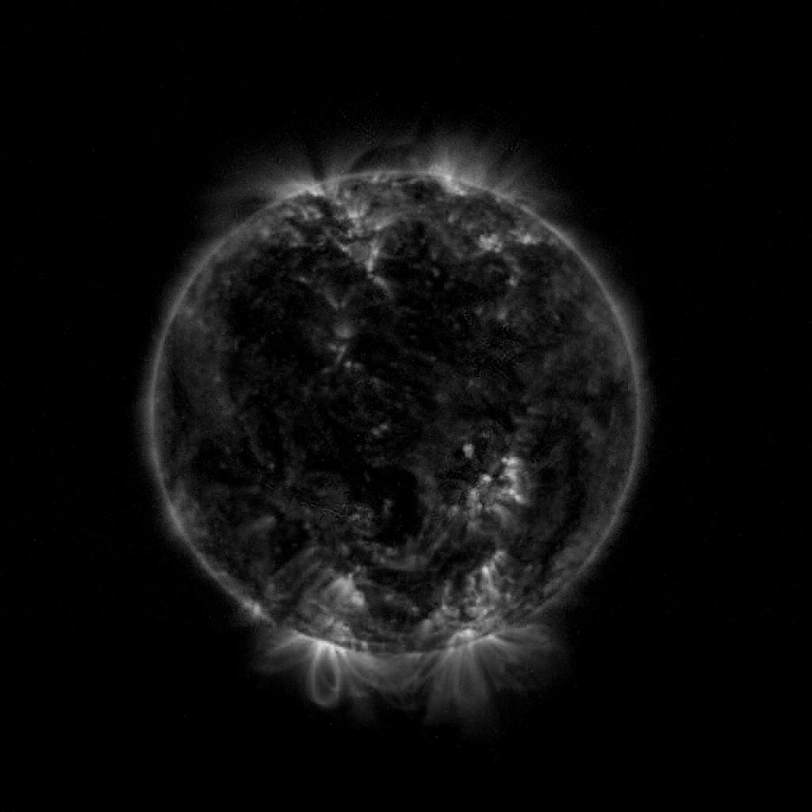 <br>
*Image received from a Proba-2 dump on 31/3/2024 at 17:46Z using a 130 cm dish, MMDS downconverter, and HackRF One. 100% quality JPEG compression applied.*

Seeing that I was not getting satisfactory results, I just moved on to other projects instead. I briefly gave it another shot in late 6/2024, but it also yielded no good results.

> Kudos to FelixTRG and Dereksgc for helping me troubleshoot and mod my MMDS, couldn't have done it without their guidance

## GVAR correction

5/2024 - 6/2024

> To be clear, you don't have to understand the below. It's overly technical and is primarily just for those who are interested in the nerdy part of the algo. I'm proud of it, so I'll be damned if I don't explain it here! I will add a TL;DR at the bottom.

Knowing I can't get a great SNR on EWS-G2 GVAR, I decided to sit down and study the GVAR format to try to figure out how SVISSR-like correction might be applied to it. For S-VISSR it is simple - each line contains all channels, so you just put one line's counter after the other, and you're done. The Earth might come out a bit egg shaped, but I think it's a worth wile trade-off.

For GVAR, it is not so simple. The format is stupid and sends little bits of each channel separately, then sends a **VARIABLE** amount of 'Auxiliary' frames. It's why GVAR is called that: **G**oes **VAR**iable. 

This means that you can't consecutively just increment a counter because there are several repeats within one 'series' of all channels being transmitted. And neither can you check frame counts to increment it, because the 'Auxiliary' frames are sent in completely arbitrary amounts. Annoying, isn't it?

After sitting on it for a while, I got the idea of applying simple majority law between all counters within a 'series' - each channel obviously has to have the same line counter, so we can just check which one appears the most often and use that instead.

> On a more technical level, we do the same thing except on a bit level - same principle, the number is just split up.

The original implementation was written in python and is still available [here](https://github.com/Meti172/GVAR-line-corrector). It went through a few iterations with more fixes to improve GVAR receptions such as masking (not allowing the numbers to be larger than the maximum), and more logic for recovering frame numbers (to identify which imagery is within said frame). Unimportant stuff. I later coded it into SatDump, where 2.0 already does this natively.

TL;DR I made imagery have less black lines in it.

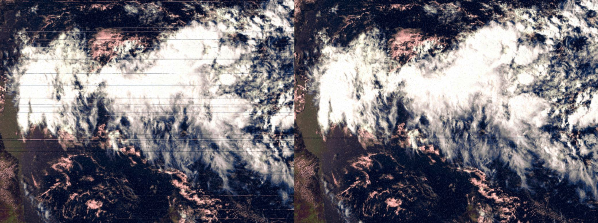
*An unknown reception before and after correction was applied. RX is likely from Zbychu, GOES-13; I genuinely can't remember.*

> Kudos to Zbychu for helping with the brainstorming

## Summer HRIT and underwhelming HackRF

07/2024

Seeing that the HackRF was capable of significantly higher sampling rates, I was under the impression that it is a vastly better SDR 
than the RTL - surely the price point was justified somehow, right? Right?!

Having switched to it, I originally didn't notice a different with LEO satellites. Sure, I was much closer to overloading my SDR because the gain sliders had way more range, but the SNR figures about matched what I expected. They even vastly improved on signals like MetOp because of the higher sampling rate margin!

Trying HRIT for the first time in months yielded weird results though. I tried again and again, failing each time, as it was too weak. Why was I suddenly getting just 2 dB when I was getting 4 before?!

I originally chalked it up to my feed being messed up - not a bad presumption given that it was still made very hastily. Constant adjustments and fine-tuning made me pull out as much as 3 dB, just on the edge of a decode. What was I doing wrong?!

It was about at this time when I found out, that the issue was in **the SDR's phase noise**. It uses a very outdated design which suffers from a nasty DC spike and huge phase noise, making it significantly less sensitive even compared to an RTLSDR!

I later empirically confirmed this on 11/2024 by testing a HRIT slot with both SDRs, swapping them mid-transmission:

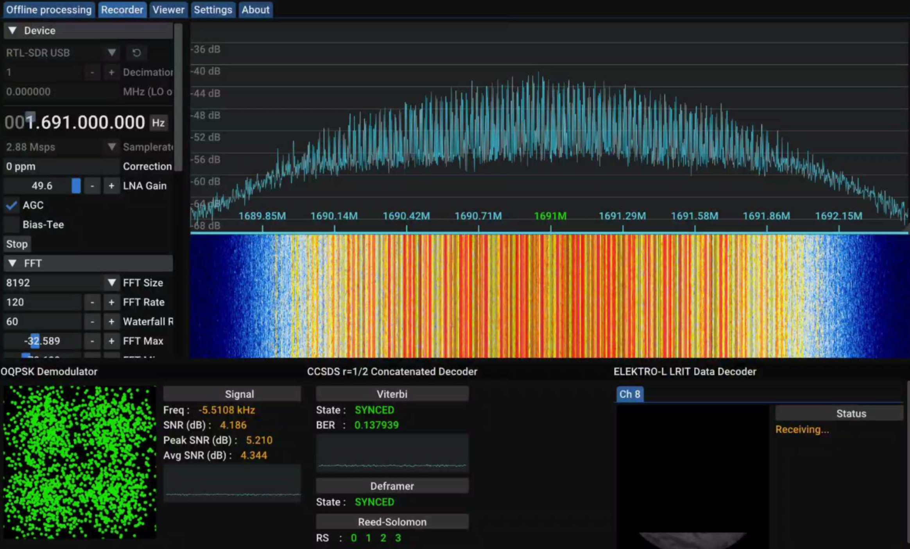
*SatDump decoding Elektro HRIT with an RTLSDR. See the SNR is at 4.2 dB. AGC is on but the SDR was not overloading.*

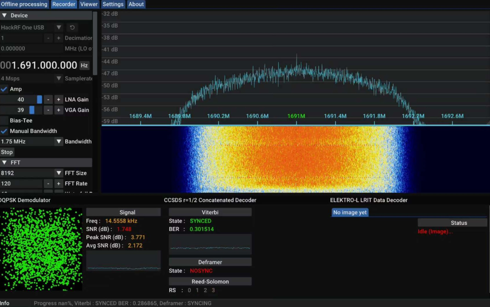
*SatDump also decoding Elektro HRIT but this time with a HackRF. Notice how the SNR is almost 2 dB worse! No, the filter did not impact the SNR, 2 MHz and above read the same. Higher sampling rates did not help either. The SDR was not overloading.*

## HRIT euphoria

7/2024

Having swapped back to the RTLSDR for HRIT, I started getting it day after day - it was super satisfying! It was also a lot of fun playing around with the composites, as HRIT transmitted all 10 channels. Most came out without any drops, allowing me to create some funky custom composites:

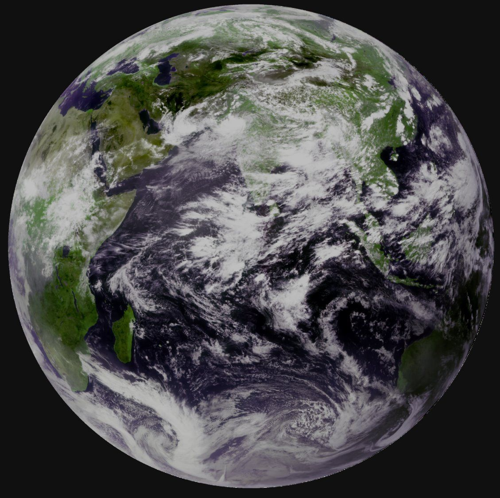 <br>
*Elektro-L3 HRIT from 5/8/2024 at 9:12Z. Received using a 130 cm dish, Sawbird GOES+, Nesdr v5. Processed using custom composite on uncalibrated imagery. Compressed.*

This one is a quickie, but I wanted to point it out as this gave me lots of experience with Elektro's lack of reliability when it comes to time slots - it skips them EXTREMELY often!! It also gave me some experience with making composites, which was nice.

> Kudos to Lego for helping with other variations of this composite


## First overnight RX

13/7/2024

This was the first time I left my dish out overnight to receive FengYun-2H S-VISSR. At that time it was my dream to create a station to receive it 24/7, but I had no suitable dishes and no suitable places to mount them.

For this RX, I just tied the dish down to a log then held it down with some firewood. I left my tablet underneath a bucket and called it a day.

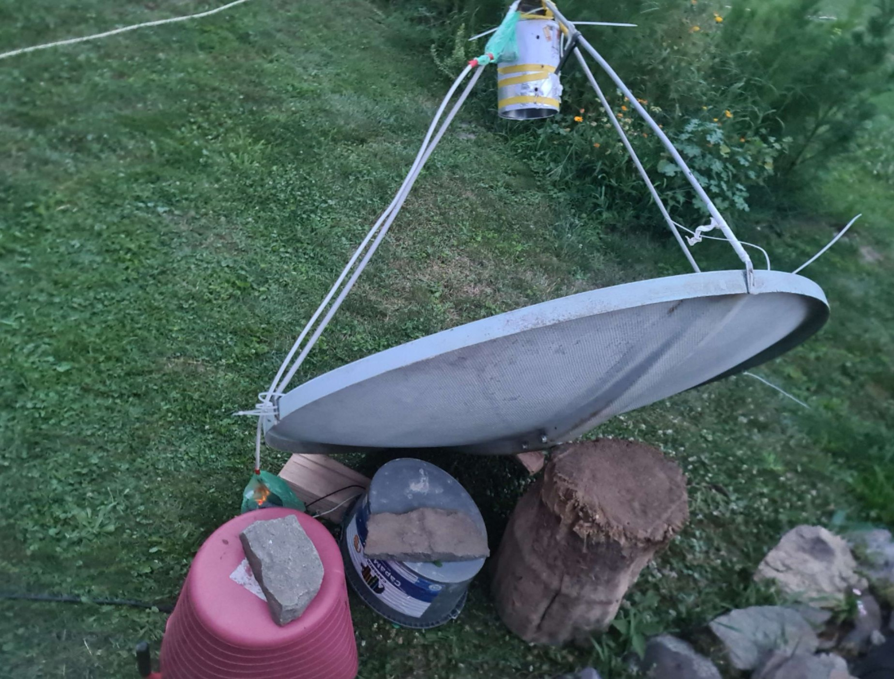 <br>
*The (in)glorious setup for that day.*

The results were not great but also not terrible, are accessible [here](https://x.com/Meti172172/status/1812526311467843873?a=HqH3UCbYx8nntkXK6tw&s=20)

(didn't include the video here because this post as it was already way too large)

## Improved craftsmanship

07/2024 and onward

Having made several helixes by now and seeing what made SNR better and worse, I made what was one of my best helixes to date:

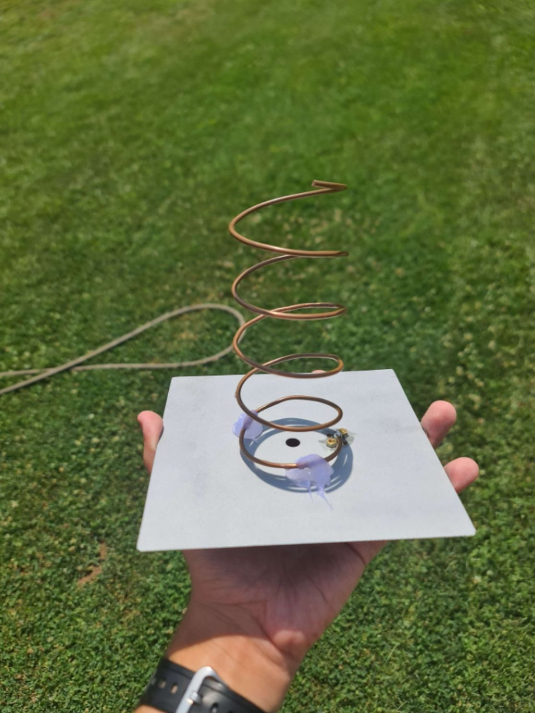
*The feed used 2/8/2024 through 18/2/2025. Designated as V5*

Using a gritty zinc spray as the surface finish and hot glue as the support, I think it looks rather clean. It gave me about a dB better SNR than my previous iterations, especially since I actually took care of the spacing this time around with a caliper.

Compared to my first helix, I think it shows that I actually started understanding what I was doing.

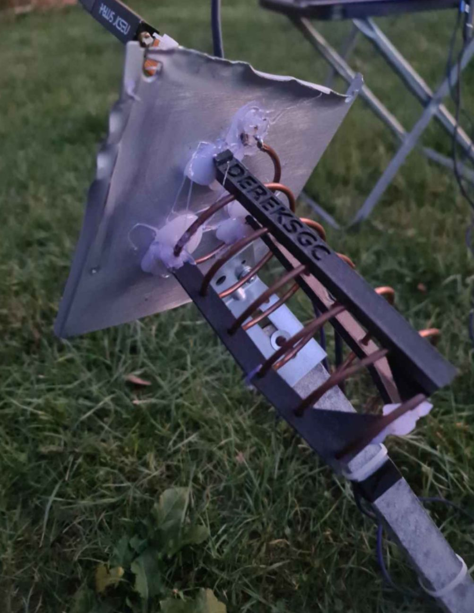
*My first helix from 12/2023 for reference, made on 28/12/2023. Designated as V0 as it fell apart within minutes.*

> If you've been keeping track of the version numbers, you might have noticed that I skipped V4. This is because it wasn't very interesting - it was just V3 with the stand cut off. It was used 07/06/2024 - 02/08/2024

## First QFH

28/07/2024

Being enamored with the idea of having a station of some kind on my own, I finally looked into VHF solutions. The beast of VHF antennas for these satellites is undoubtedly a QFH!

Even though it was difficult to make, I decided to give it a shot. After a few hours of work, I erected it and... It sucked! What was wrong?

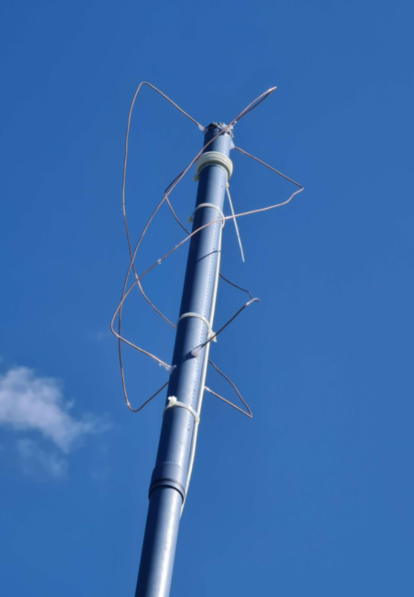
*The fixture which performed very poorly. If you know anything about these, you can probably see the issue already.*

If you read my VHF guide, you already got a clue with the big disclaimer next to these. **I done wired it up the wrong way.** Instead of going clockwise [looking top-down], I twisted the wire counter-clockwise. This inverted the polarization, essentially completely nullifying the signal. It took me embarrassingly long to realize this. At least I pay extra attention to polarization now! ~~If I had a nickel for every time I spotted someone messing the polarization of their antenna up, i'd have.. a few nickels.~~

After having taken it down a couple of days later, redoing it from the ground up (while cursing out ten different deities), I finally started getting decent images!

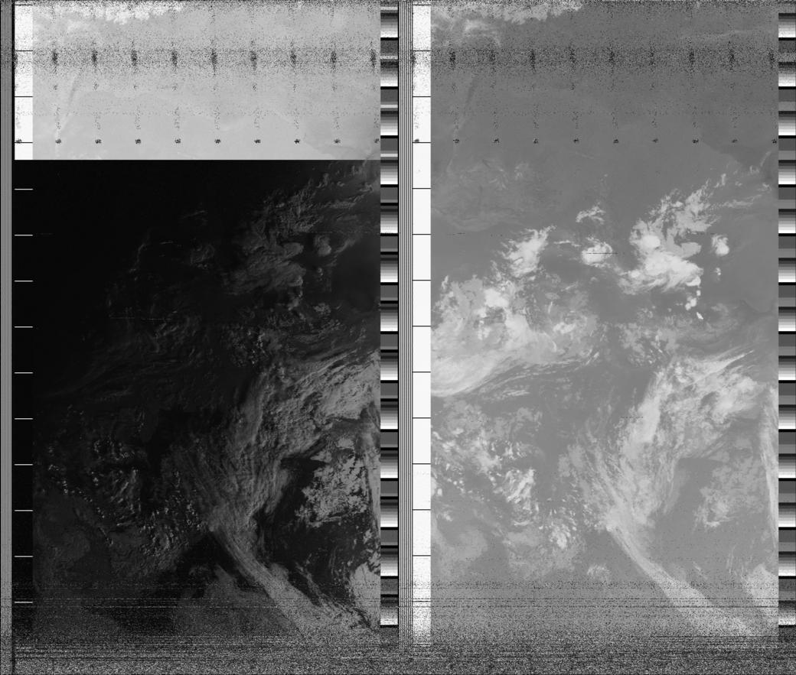 <br>
*NOAA-15 APT received on 3/8/2024 at 12:29Z using my QFH without an amplifier. Some interference is present from a source that I never ended up finding. 90% quality JPEG compression applied, resized to 50%.*

I couldn't figure out a way to run SatDump reliably without drops yet on my Raspberry, so I put the QFH project on the back burner, occasionally using it for other things - it is a good and well-positioned antenna after all. One of the fun things I ended up using it for ended up being listening to the ISS - I managed to catch it during a school contact. It was cool hearing the astronauts speaking directly to someone (:


## Projection of my QTH visibility

06/08/2024

Another quickie, between these major bullet points I was always doing the odd HRPT. One day I decided to map out the coverage I can get from LEO satellites from my QTH (location) by projecting all passes I had from that day, with this being the result:

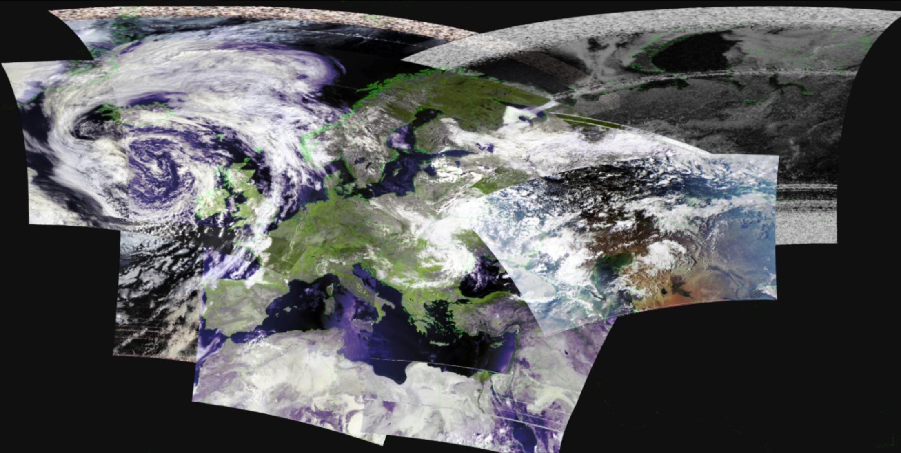
*A projection of roughly 6 passes including NOAA HRPT+APT, FengYun-3C AHRPT. All passes were received on 6/8/2024. 80% quality JPEG compression applied.*

Seeing this amount of coverage was the first seed for the idea of making a big projection. No spoilers though (:

## New, prime-focus dish

8/8/2024

On a ride home with my father, I noted that a house had a PF dish and that it's a shame they aren't sold anymore. In an off-hand comment he said one of my neighbors from just a couple houses down still has one from the Czechoslovak era. This, naturally, surprised me - especially after having to buy a dish from the other side of the country before!

Right after arriving home I went over to the neighbor who just so happened to be IN THE MIDDLE of the process of scrapping the dish; he already cut the mount off (huge shame), was preparing to scrap the dish as well when I stopped him. After telling him about this hobby he let me have it instead, which is how I got my 120 cm PF! **From a few houses down!**

> This does bring up the idea of how many of these might be found in random peoples' backyards... Food for thought.

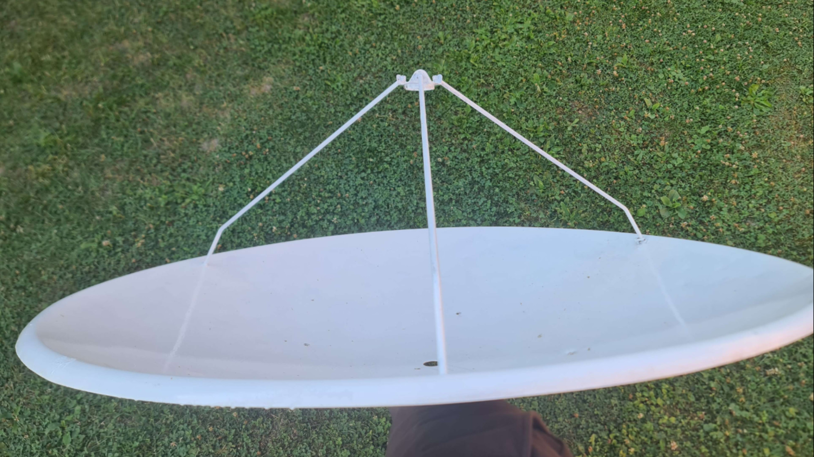
*The dish in question. Nice and straight - perfect for my uses!*

Being a prime focus instead of an offset, it was stupid easy to get the focal point right. In addition, it was stupid easy to skew as it had no right way up. This is where I realized the mistake I have been making with my offset all along - not skewing the feed!

I tested the dish with a cantenna, it worked very well. I then made a crappy loop which hardly worked because of sloppy craftsmanship, the cantenna easily beat it.

## VHF station proof of concept

17/8/2024

After fixing the QFH up again by bringing it down and readjusting the elements, I then also figured out that *rotating it* made all the difference. Imagery suddenly became much clearer, giving me horizon to horizon coverage. Sweet!

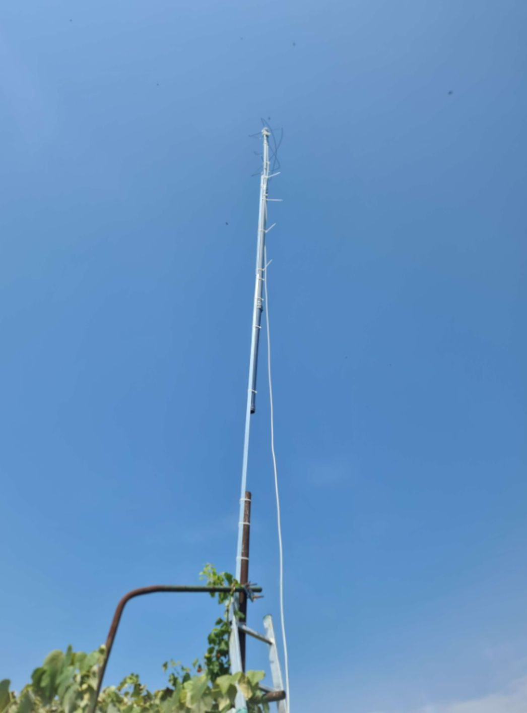 <br>
*The QFH mount at this time*

This also produced my all-time favorite APT image:
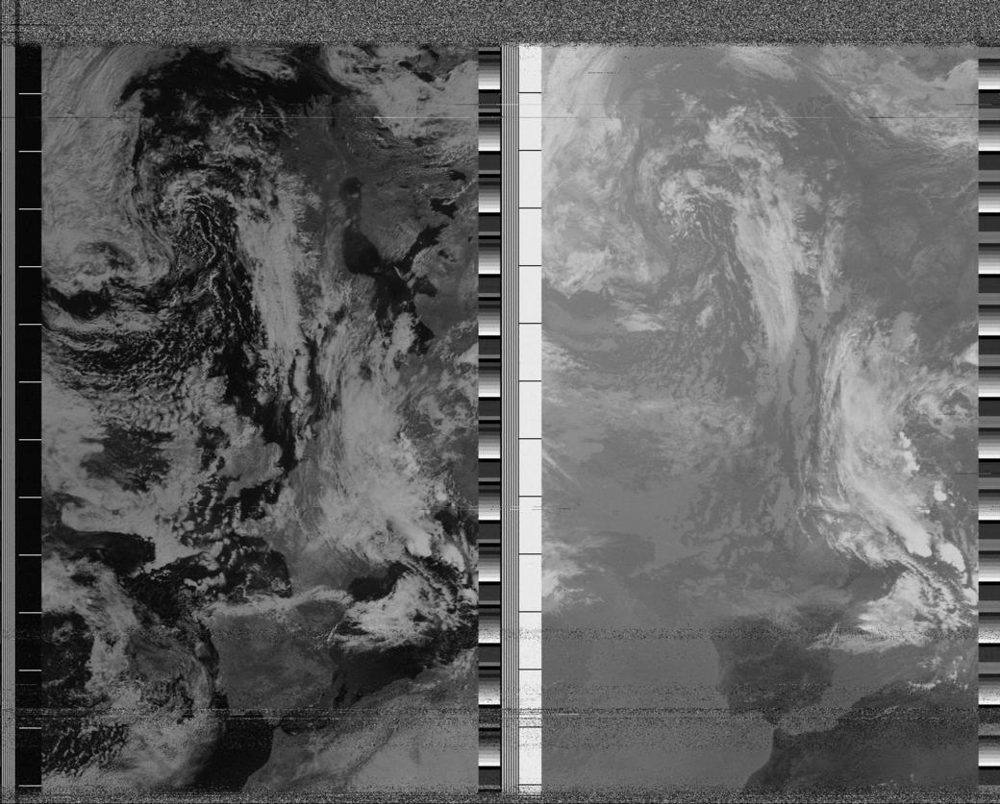 <br>
*Raw, synced NOAA-19 APT from 18/8/2024 at 10:03Z received using a QFH. Compressed, resized to 50%.*

## S-band part two

circa 31/8/2024

I decided to give S-band another shot on this day, seeing as the summer was about to end.

I remade the helix to be a bit more sturdy, tried a new position for the dish. While not great, it was an improvement on the first S-band attempts from July - I even got a bit of NOAA GAC!

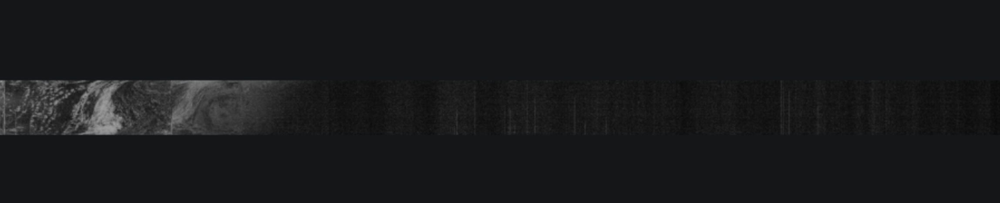
*Horizontal AVHRR channel 1 from an unknown NOAA received on 31/8/2024 at 19:59Z. For whatever reason I only have the image files and no dataset nor .cbor file I could use to properly project it. Darn!*

## Night projection

12/10/2024

I decided to go out in the evening on this day and catch as many satellite passes as I could; just to see how the final projection would look like. The answer is this:

TODO: find actual projection, i have all the files but cba to project them atm

The coverage gave us in the dereksgc server the idea to combine several people together - I had very good Easterly LOS after all.

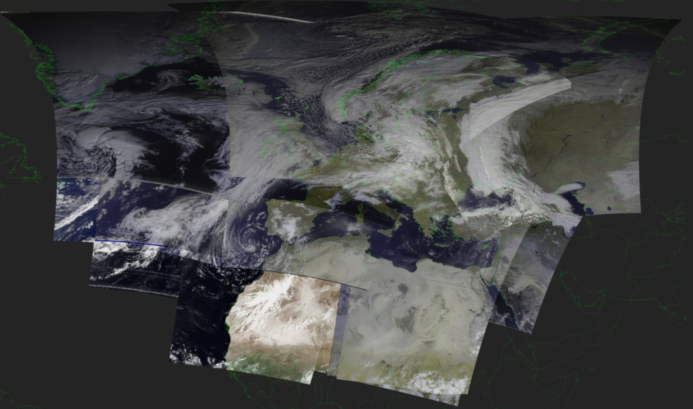 <br>
*The projection from 14/10/2024 created in the Dereksgc server. I do not have the full credits anymore, but going off of head, this projection includes passes from: Yours truly, T0nito, Digitelektro, Ledflighter, Elmarko. 90% JPEG-compression applied, resized.*

Elmarko and I thought we might be able to group up even more people for this, potentially creating a sort of **mega projection**. After careful planning, we ended up making this real:

## Megaprojection organization

11/2024

Elmarko and I started doing research into how we could get as much coverage as possible from LEO satellites. With the help of Slawek and others, we managed to organize 34 people to sign up to send their data for the megaprojection dates, that being 30/11 and 01/12.

I primarily worked on the spreadsheets and tracking availability, whereas others worked on getting the contacts and actually projecting the data. Eventually we only ended up projecting 30/11 because there was a lot of missing data from 01/12 from a lot of locations. The 30/11 projection result is, however, absolutely stunning:

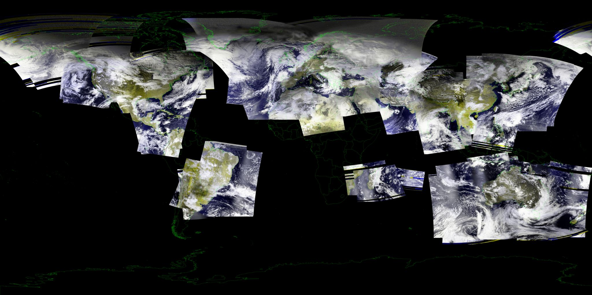
*Megaprojection of NOAA-18 and Meteor M2-4 passes on 30/11/2024. Full credits as well as a project description are both available [here](https://docs.google.com/spreadsheets/d/1TKlwnO8NY7tNF7BB8cw_VnUSPreX-nwFG8gQBDQxMMY/edit?gid=1466359569#gid=1466359569)*

Organizing this was a lot of fun, but it is unlikely to happen again as it specifically used the fact that NOAA-18 + Meteor M2-4 orbits are shifted in phase by 180° - one passes North in the afternoon whereas the other passes South. This greatly improved the coverage each station got. Unless similar satellites are launched in the future, I don't think a project like this will be AS feasible as back then. **But you know what they say - never say never (:**

## VLNA reveal

06/2024 - 12/2024

You might notice that we are suddenly back in June - don't worry, all will be explained. Back in June, I was desperately trying to source a G4DDK VLNA - the Sawbird GOES+ revision I had was really crappy, whereas the VLNA was the unanimous champion of L-band amplifier. So I started looking for it.

I managed to source one mid-June, I ordered the parts for it and started waiting for them.

Some took way longer than others because, but I *finally* got everything I needed in 30/8. However, after manufacturing it, something was wrong - I couldn't see any signals!

After troubleshooting it by doing various ad-hoc measurements, I eventually gave up on it. At the end of my wits, I tried messaging G4DDK himself to see if he could offer any assistance. To my luck it turns out that he's an absolute saint - he agreed to have me send him my VLNA to be tested & repaired. I can't put into words how grateful I am for him doing that <3

I got it back a few weeks later and got to test it on 24/11/2024, where I got excellent results! GVAR had an SNR of 8 dB; 2 dB higher than what I had before. This was plenty for receptions without any significant drops *even with SatDump 1.2!*

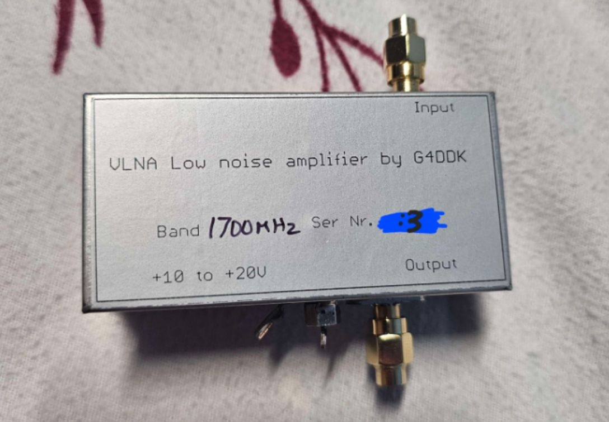


## Dishless Australia

12/2024

In December 2024, I went on a trip to visit my family in Australia. Naturally, I didn't want to let a chance to receive Aussie satellites go to waste. So, I ended up bringing most of my RF setup with me.

Initially, I had no dish. So I began with what you'd expect; GK-2A LRIT. I was pleasantly surprised by how ridiculously strong it was - dropping my helix randomly without any effort pointing already had enough SNR to decode imagery!

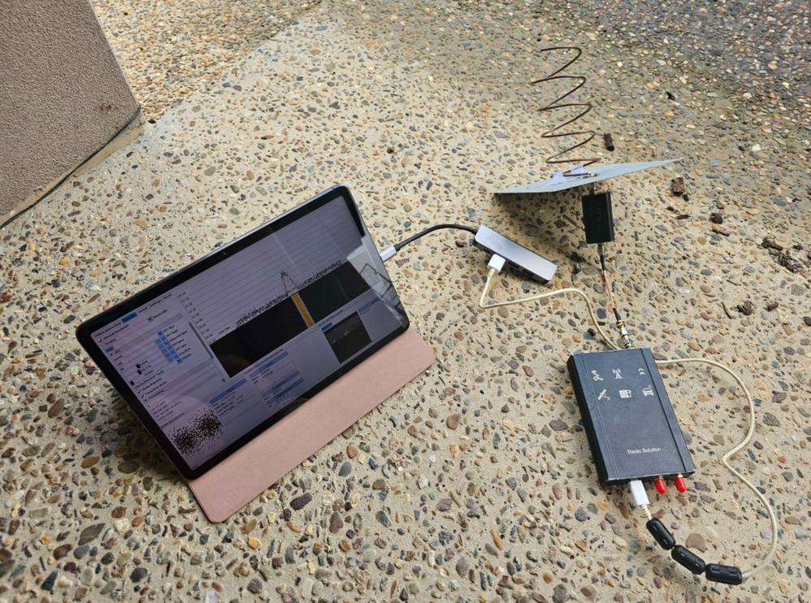
*3 dB on GEO-KOMPSAT-2A LRIT from a helix I randomly placed on the ground, and that's with a HackRF!*

The only imagery that is transmits is a simple 10.8 um IR, only really usable for a few composites:

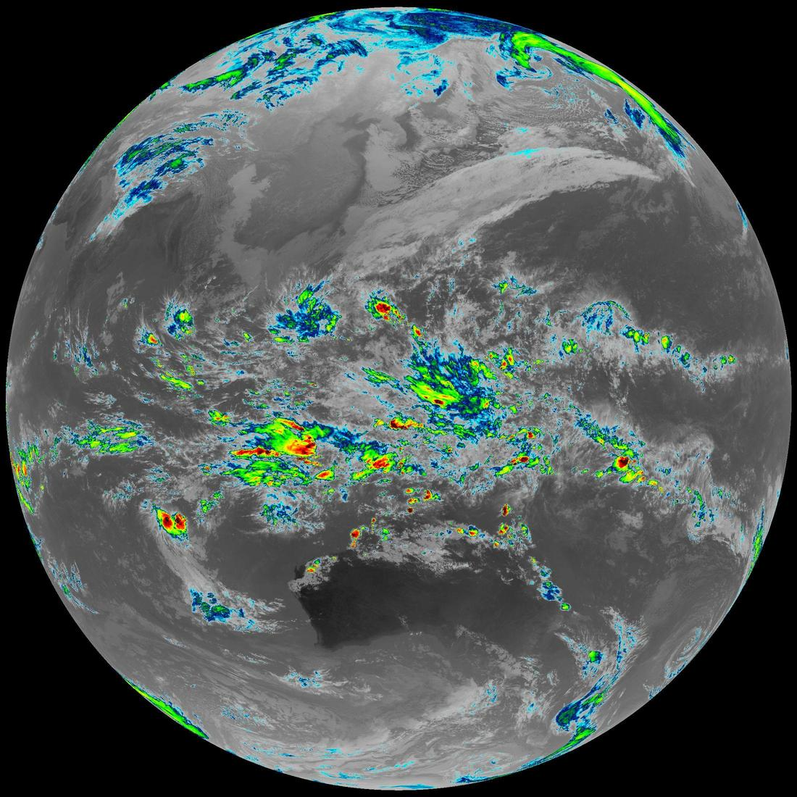 <br>
*GEO-KOMPPSAT-2A LRIT received on 28/12/2024 at 18:50Z by yours truly using a 5 turn helix dropped on the ground, SawBird GOES+, HackRF One. Processed using SatDump with the `Clean Longwave IR Window Band` composite. 80% quality JPEG compression applied, resized 50%. Click [here](https://sat-archive.metislair.com/L-band/GEO-KOMPSAT/LRIT/GEO-KOMPSAT-2A/2024-12-28_08-50_gk2a-lrit_Meti/ami_Clean%20Longwave%20IR%20Window%20Band.png) for the full resolution image.*

It also transmits some other miscallenous data, some of which you can view [here](https://sat-archive.metislair.com/L-band/GEO-KOMPSAT/LRIT/GEO-KOMPSAT-2A/2024-12-28_09-06_gk2a-lrit_Meti/ADD/).

# 2025

Having gotten my bearings with L-band by now, I started trying to polish my setups. I obviously still made mistakes, but they were more random rather than originating solely from ignorance.

## Dishful Australia

01/2025

Shortly after NYE, I started looking at the used market to see if I could source a big dish somewhere. A lot of people were selling their old 230 cm dishes, but they were often several meters up on roofs, rusted to hell, or completely bent out of shape. In a stroke of luck I managed to find a 230 cm one near where I was staying, without significant damage to the mesh, and for free!

After treating it with insect spray (there were some ants nearby and it's apparently **very** illegal to spread them to other parts of the city), we managed to take it back home for me to assemble.

I did sadly forget to take one of the 4 mounting arms, as I disassembled the dish at night and didn't notice it was left leaned up against a wall... oops. To add insult to injury, I didn't have any real power tools, meaning I couldn't just drill a new hole and use a triangular setup. Thankfully, the dish thankfully held up fine enough to use with only 3 arms.

The first satellite I attempted was, naturally, GEO-KOMPSAT 2A's HRIT transmission. It came in way stronger than necessary:


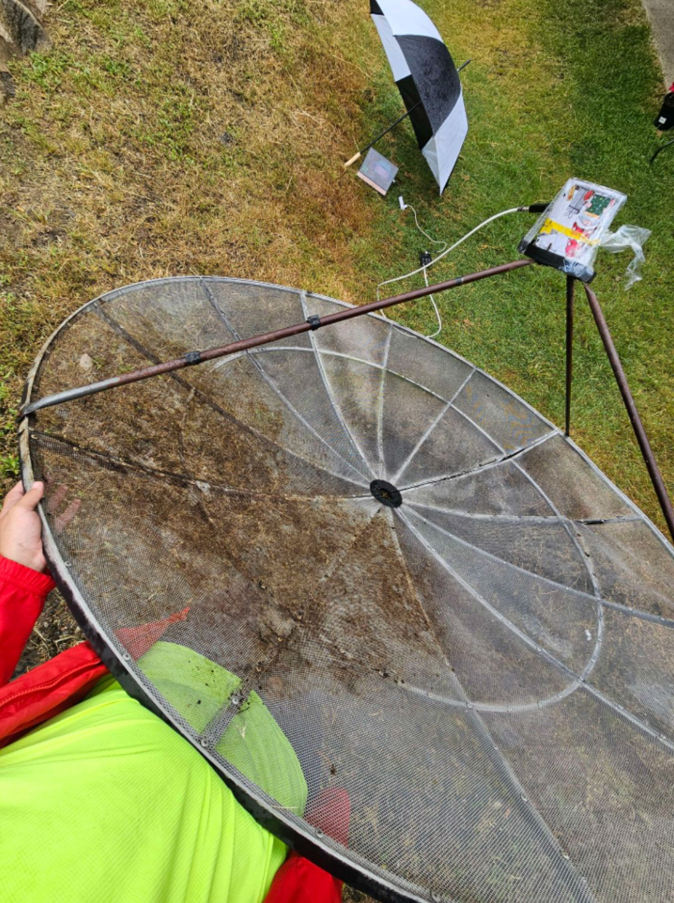 <br>
*Yours truly receiving GK2A HRIT from the family backyard using the fabled cantenna, SawBird GOES+, and a HackRF One. RX was roughly at 8 dB, plenty for clean imagery*

The imagery was glorious, I couldn't get enough of the high resolution full disk images. The temporal resolution was also sweet - missing one spot meant nothing as I could just wait a few minutes and get the next one instead. I still envy you guys!

This also got me one of my favorite images I ever received from a satellite:

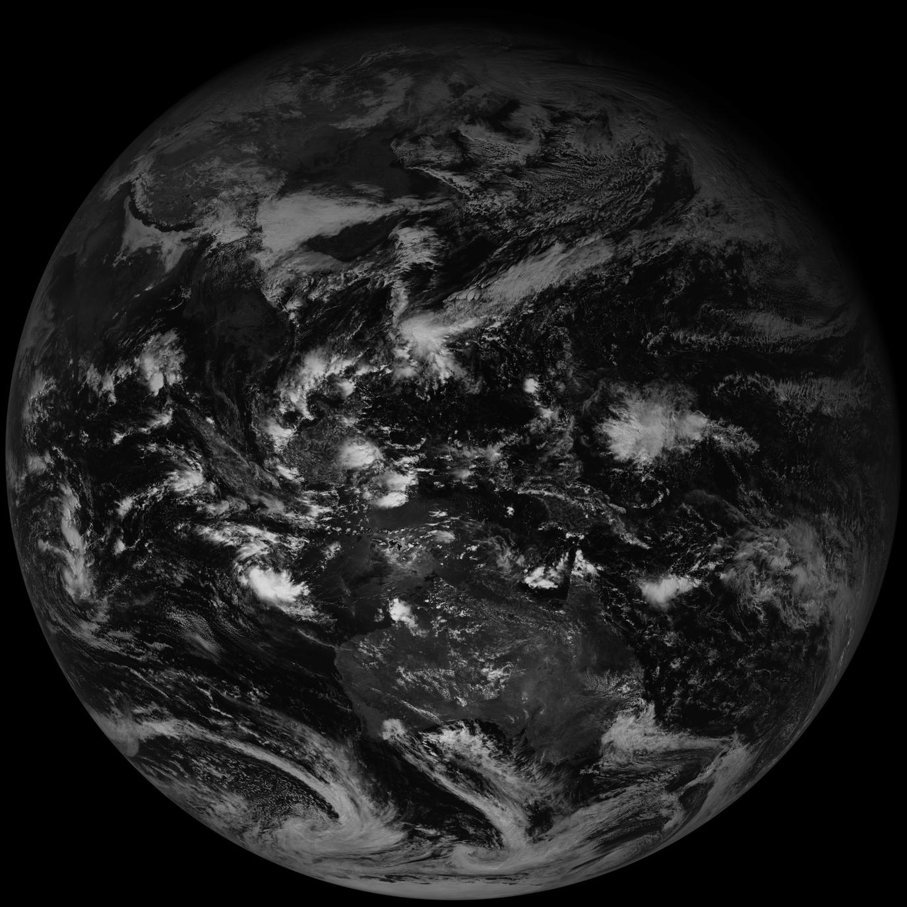 <br>
*GEO-KOMPSAT-2A HRIT Channel 1, received on 8/1/2025 at 04:26Z using a 230 cm dish, cantenna, SawBird GOES+, and a HackRF one. 80% quality JPEG compression applied, resized to 12.5%. You can access the full resolution image [here](https://sat-archive.metislair.com/L-band/GEO-KOMPSAT/HRIT/GEO-KOMPSAT-2A/2025-01-08_04-26_gk2a-lrit_Meti/GK2A_VI006_20250108T042636Z.png)*

The cloud texture on the right-hand side always stuns me. 1 km/px is an absolute privilege, especially when it is preprocessed for you!

> Preprocessed as GK2A does xRIT, which already calibrates and centers the Earth Disk


## GRB attempts

7/1/2025

Still in Australia, I realized, that GOES-18 is just above my horizon. Technically, if I went to this super specific spot in my backyard and leaned the dish against the fence...

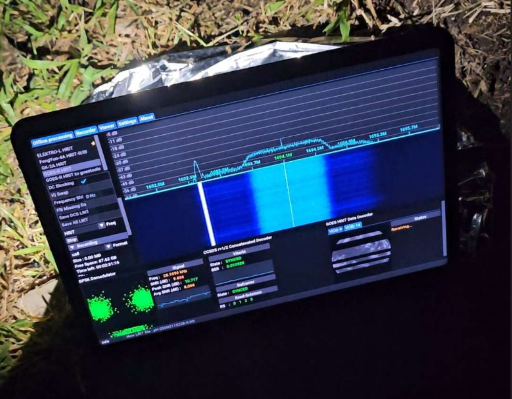 <br>
*My tablet decoding GOES-18 HRIT at 10 dB. The satellite was just at 8.9°. Excuse the poor image, I didn't make any proper screenshots of GOES HRIT as I primarily focused on GRB. You can see some interference quite well though.*

HRIT was child's play, with a proper skew I got it as well as 13 dB! With a dish this size, the more worthwhile thing to try to get was GRB - being much wider and weaker than HRIT, it would be quite an achievement to get it.

> Note: Being circular and using both LHCP and RHCP separately, I had to use my helix instead of a cantenna to receive only one data stream at once - using a cantenna would mean I receive two different streams at once, the overlap would render them gibberish.

So I tried to receive it, and I got super close! However, several things were my downfall:
1. I had no proper feed - the helix is not optimal for a prime focus, I haven't made a patch yet at that time.
2. The HackRF's phase noise made it weaker than it should have been by a dB or two
3. SatDump's DVB-S2 decoder is not optimal, needs a touch higher SNR than others to get good data
4. My phone kept dropping samples at the full 20 Msps, so I had to resort to using circa 15 Msps, which is 1 Msps below the recommended minimum (The signal is 8 MHz wide, you want to sample twice as much)
5. When I got a laptop during the last few days, it was the stupid ARM and the drivers didn't work at all with the HackRF. The laptop also didn't support any Linux distro (still doesn't!), so I couldn't just live boot. I still hate the laptop to this day.
6. Using my VLNA did offer an SNR improvement, however, with it being unfiltered, it made the spectrum unusable. Interference from Brisbane's CBD completely drowned the signal out in bursts. I sadly had no standalone SAW filter to use.


All of this made me end RIGHT on the edge of a decoding data at 7.5 dB:

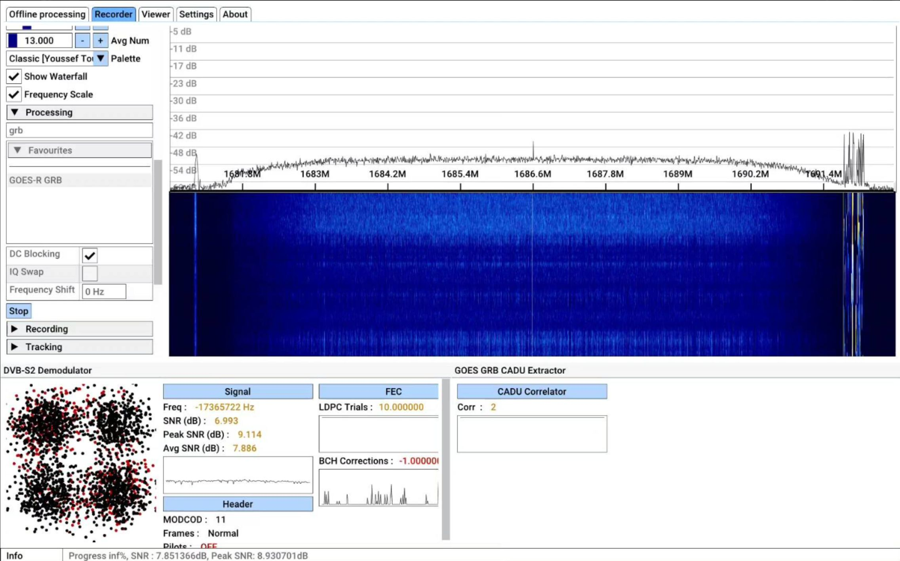 <br>
*SatDump running the GRB pipeline. BCH correction spikes mean that data was decoded, but it was at `-1` most of the time meaning I didn't get most of it. A single dB would have pushed me over the edge. Darn!*


Even though it wasn't enough to get a consistent data decode, I did decode a few 'bites' of GRB which I already consider a proof of concept that it is not only possible, but *feasible* to get GRB from Australia.

TODO: recovered images here

Given that GRB didn't work properly, I at least got some hilariously strong Elektro-L4 HRIT:


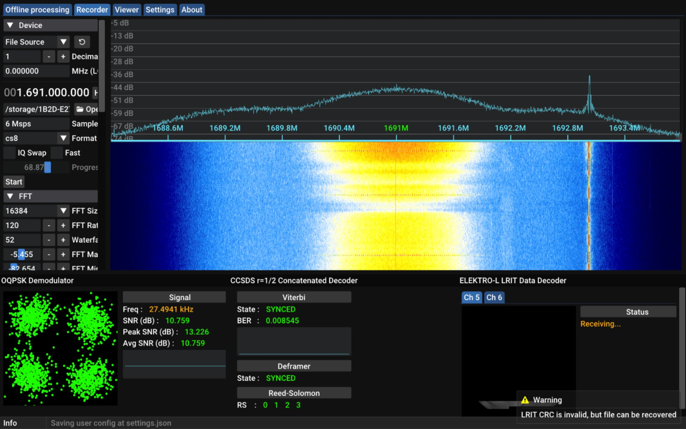
*SatDump decoding Elektro-L HRIT at a peak of 13 dB. CRC errors were a problem on the satellite side*

I finished the trip with some more GOES HRIT.

TODO: HRIT pic, it is in ordered backups but stupid old satdump. shimmable


## Original direct reception helix

03/2025

I'll keep this brief as I have a whole write-up accessible [here]({{site.baseurl}}/docs/Radio/Creating a helix for direct satrx).

I always wanted to do portable satellite reception; especially when at my home in the city (I normally did satellite reception at my cottage). To achieve this, I considered making a helicone, but I felt like it was too bulky and overengineered. (I also had no 3D printer yet.) So I instead decided to give making a bare helix a shot. In theory, it should work perfectly fine!

And work fine it did. Even better than a lot of my friends expected! Most notably I was told LRIT with it will be impossible, and yet I managed to get it at 1.5 dB. The post I made about it even got featured on the RTLSDR blog! (before it started promoting vibecoded stuff almost every other day)

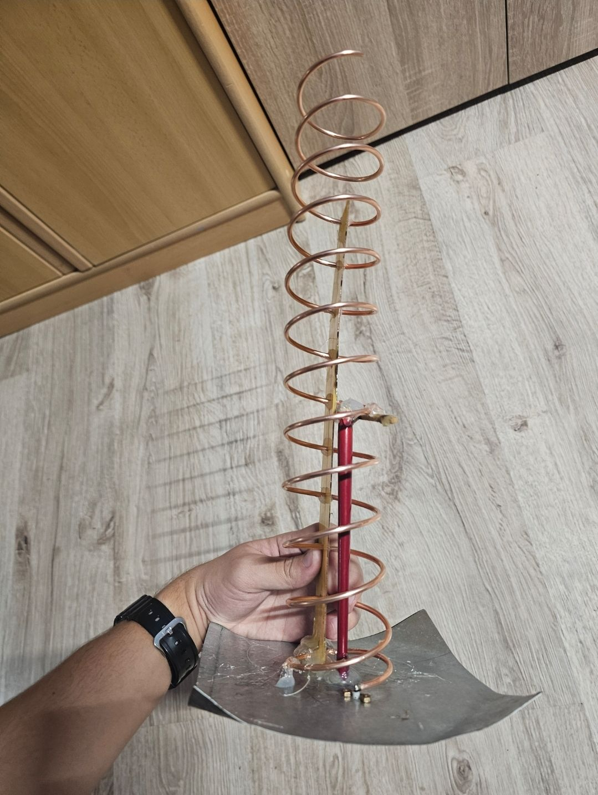 <br>
*The final design which got me Elektro-L3 LRIT at just a 12° elevation. For more details, visit the article linked above*

A semi important thing that happened shortly before was, that I was gifted an Airspy R2 from @KentuckyFriedData. I'm still incredibly grateful for that. Big kudos to ya <3

## Feed and USB incidents

4/4/2025

Did you ever have a day when it felt like everything was going wrong? This was one of these for me.

Having been away from my cottage for a while, I stowed my dishes in my shed as far out of the way as possible. When I came back after a few months, I immediately noticed the dishes were moved. Uh oh.

As it turns out, my parents ordered some firewood, and the workers decided the one spot in the entire shed where I had my dishes **SAFELY** stored was the perfect spot to put it.

So the workers came, and just *threw the dishes on top of one other on the side of the shed*. I'll let the pictures speak for themselves.

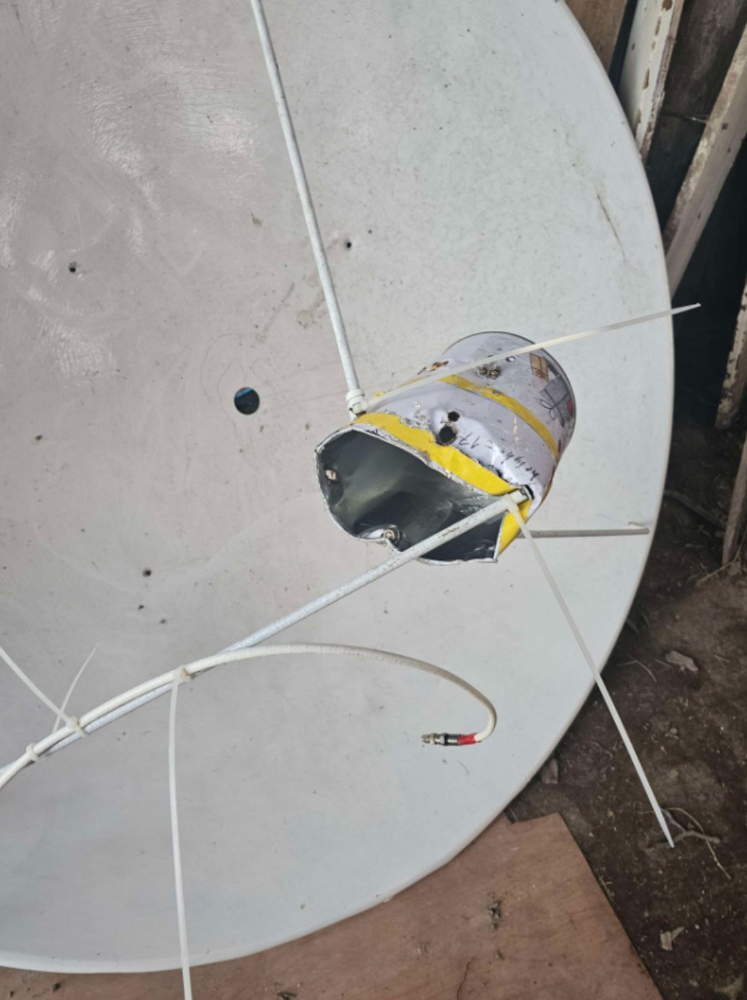

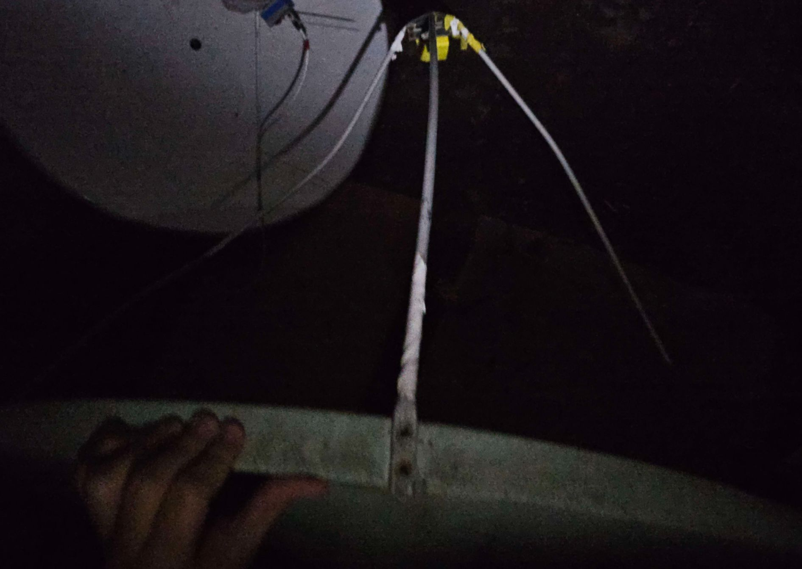

I was, rightfully, quite mad, especially with the PF as I spent hours getting the cantenna to be in the perfect focal point in November. Now, the cantenna was basically busted. I tried realigning it to the best of my possibilities, but I never got as high of an SNR as I did before - I lost about 1 dB because of this incident.

The offset dish also saw damage, as the feed arms were completely bent. This made me lose the optimal focal point on the dish, as I never got them to be as straight as they were ever again. Super annoying!!!

Just hours later while trying to realign the cantenna again, I noticed the Airspy R2 refused to stay connected to my laptop. What was going on?!

It turns out the stupid, idiotic, useless, horribly designed bane of my existence that is the **micro USB standard** decided it had enough of its life. It was time to replace the port. Simple fix, right?

As I learned way too late, the flux I have been relying on is not just bad, it was **awful**.


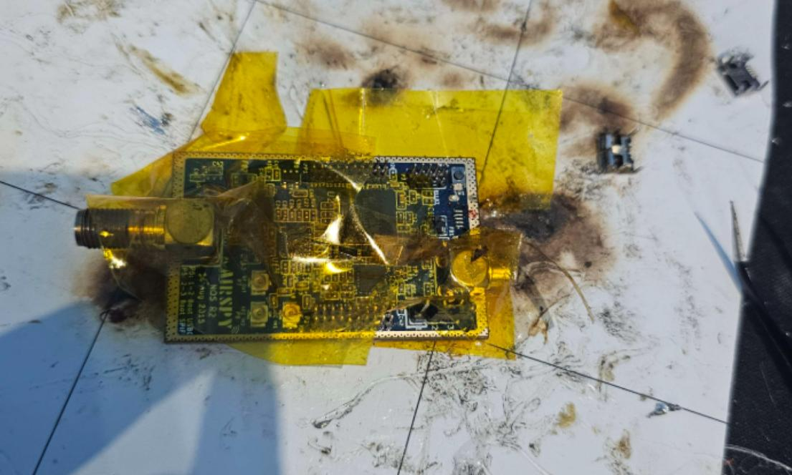
*The patient, mid-operation. I was still following all proper safety precautions at this time; hence all the Kapton tape.*

Resoldering the USB felt impossible - the connection KEPT dropping whenever I bumped the port. No matter how many reflows I did or how much flux I added, the solder still remained brittle and never made good contact. The fake RMA223 might have been fine for other projects, but it was no match for the tiny USB pins.

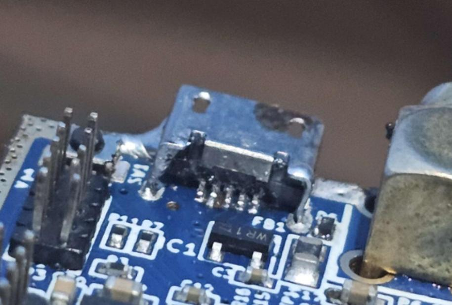 <br>
*A picture of the state of the port after the repair. You can see the solder is barely bound to the pins at all... The NC (no connection) pad was ripped because of high heat, but it didn't matter as it was literally just a tiny pad not connected to anything.*

The repair held for the time being...


## New cantenna

19/4/2025

Following the permanent damage suffered by the old cantenna, I was forced to make a new one.

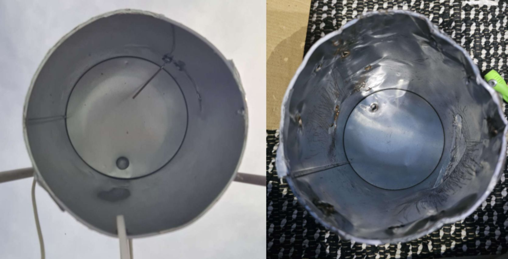 <br>
*The cantenna when I just made it, and after I decommissioned it. It went through a lot. It literally even travelled around the world! RIP*


I was checking the store where I bought the piggy bank continuously over weeks, but they never restocked it. So I turned to an alternative solution for getting a can of the correct diameter - A chimney pipe!

Extremely heavy and extremely difficult to cut, I do not recommend anybody do this crap. It sucked. 

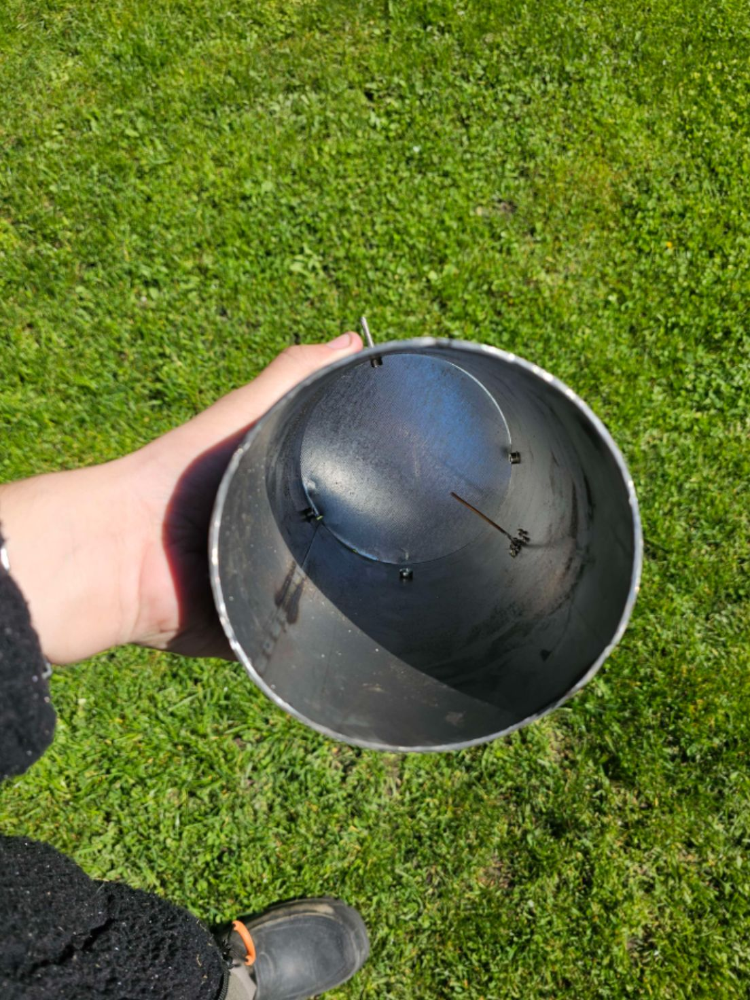 <br>
*The new cantenna in all of its glory. The bottom is a place I riveted to it.*

Drilling this thing sucked as well, as the steel was super thick. Thankfully, I managed to get it onto the prime focus dish after some... okay, a *lot* of effort. I used to use the malleability of the old cantenna to my advantage by slightly bending it when screwing the feed arms in, whereas with this one I had to manhandle it until all feed arms were in the mounting holes properly. Not a fun experience.

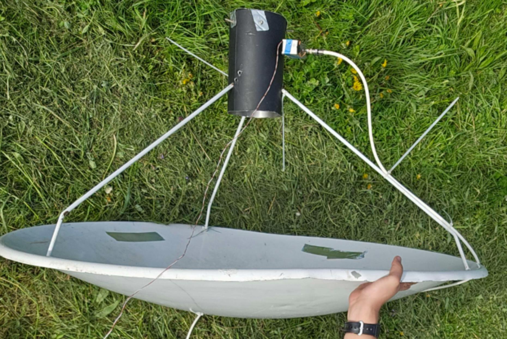 <br>
*The new, incredibly front-heavy dish. It is also quite a bit bent, damn. I never noticed and I'm writing this in 10/2026!*

## Portable dish setup

20/4/2025

With it being summer, my visibility on L started becoming greatly limited because of leaves. So I instead considered cycling somewhere with my dish.

Although it was extremely bulky and almost made me crash my bike several times, I managed to cycle out a few km while holding the dish in one hand and the steering wheel in the other. I cycled to a spot which had basically unimpeded LOS 360°. I used this to my fullest advantage, getting as many morning passes back-to-back as possible.

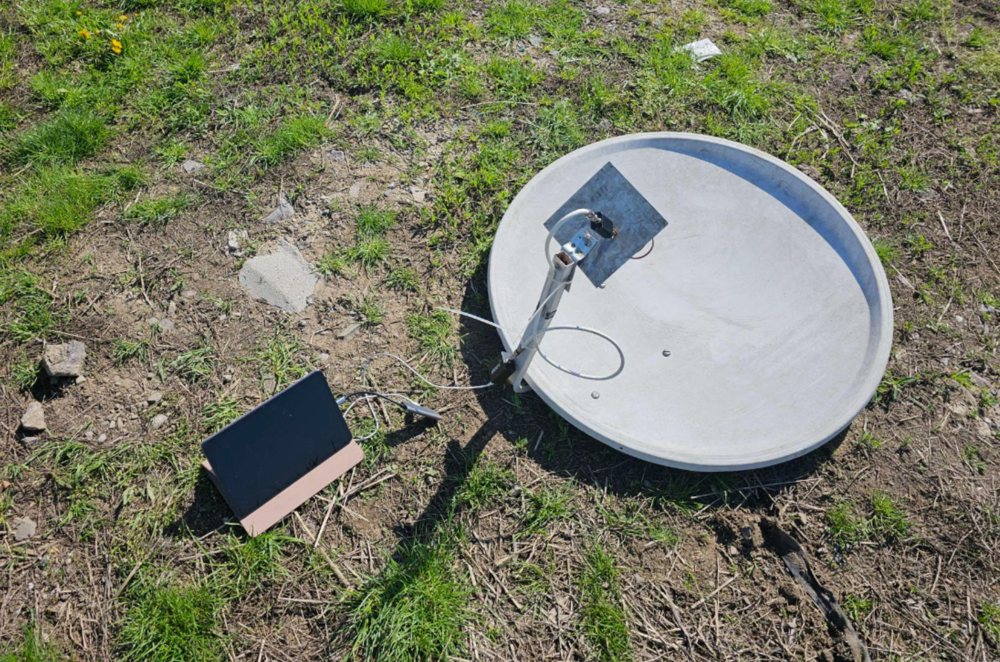 <br>
*The glorious portable setup taken in the middle of nowhere.*

It managed to get me my longest Meteor HRPT pass yet at 5684 MSU-MR lines:

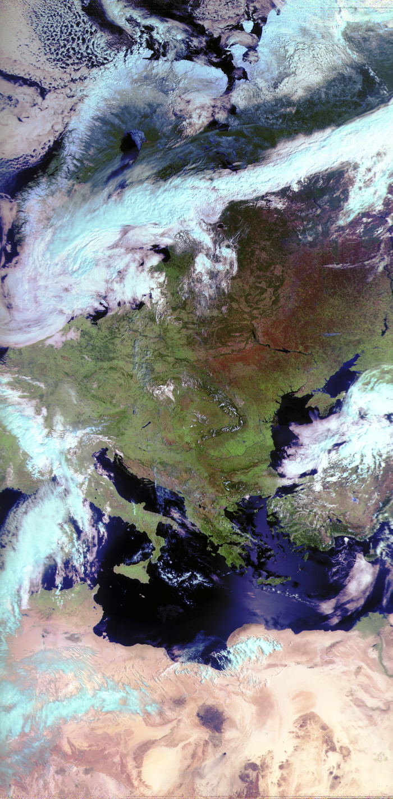 <br>
*Meteor M2-4 received on 20/4/2025 at 08:14Z using an 80 cm dish, SawBird GOES+, Airspy R2. Processed using SatDump using the `Natural color` composite, individually equalized. 90% quality JPEG compression applied, resized to 25%. Full resolution image as well as pass .cadu are both available [here](https://sat-archive.metislair.com/L-band/Meteor-M/Meteor-M2-4/2025-04-20_08-14_meteor-hrpt_Meti/)*


## Second QFH attempt

20/4/2025

You might have noticed in the first QFH heading, that there is a gap between the steel pipe it was mounted to and the PVC pipe the QFH itself was mounted to. This wasn't optimal, but I thought the metal profiling was enough to keep it stable.

Then I received a picture from my mother showing the QFH on the ground, having broken at the weak point between the metal and PVC pipes. I wish I could include it here as it is absolutely hilarious, but it is a tad too revealing of the QTH. Enjoy an artistic interpretation instead.

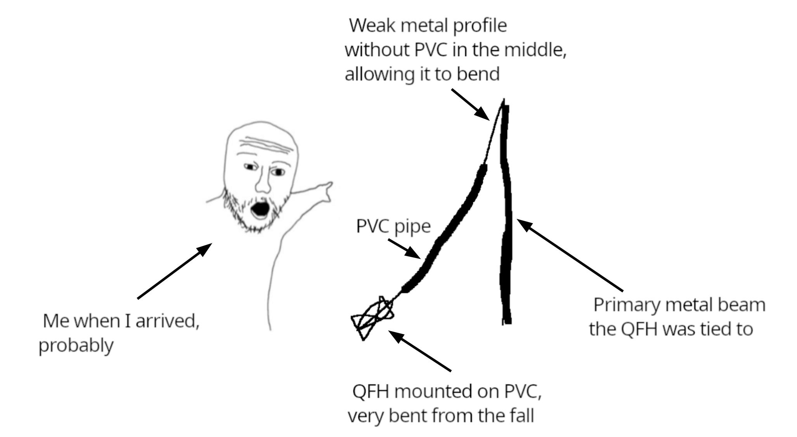 <br>
*The very undignified position the QFH was in. My artistic genius knows no bounds.*

This happened in February. I kept the PVC section of the QFH fixture in my shed since then, ready to be resoldered and patched up. This was the faithful day when I did so.

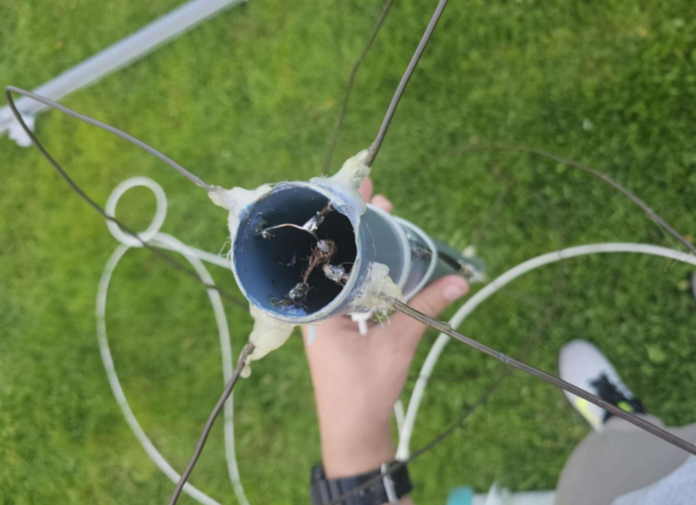 <br>
*The lovely soldering job I did with some crappy old coax which had a copper shield. I originally used one with an aluminum shield, it SUCKS to get a proper electrical contact with.*

Over the next couple of days I tested different mounting positions and brought it down several times to tune with a VNA. After some effort, I finally got results which I deemed satisfactory. You might notice that this is when I added several passes to my archive with an IQ, that's specifically because it was as good as it was.

As a side note, this is also the first time I used a Saw BPF+LNA for 137 MHz, it worked quite well for how cheap it was, buying me about a dB.

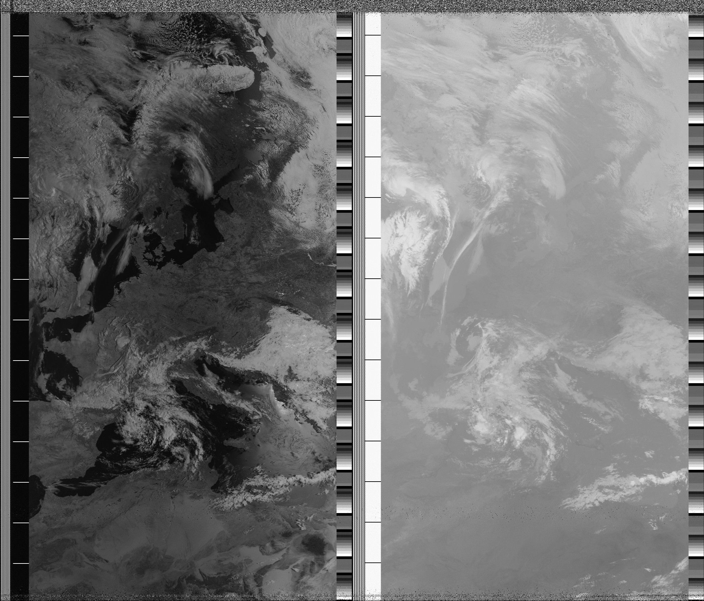 <br>
*One of my best APT images I ever received from NOAA 15, received on 27/4/2025 at 06:54Z using a QFH, Saw BPF+LNA 137 MHz, and Airspy R2. 80% quality JPEG compression applied. Full pass including baseband is available [here](https://sat-archive.metislair.com/VHF/NOAA%20POES/APT/NOAA-15/2025-04-27_06-54_noaa-apt_Meti)*

I also tried setting up scheduling with my Raspberry Pi, but that never went anywhere as the power setup was too janky to be left as-is.

## NOAA-18 Farewell

6/6/2025

Another quickie, NOAA-18 was decommissioned on the 6th of June. I made sure to receive the final transmission, although I didn't get to see the cutoff (it happened just below the horizon), I caught it up until the last minute.


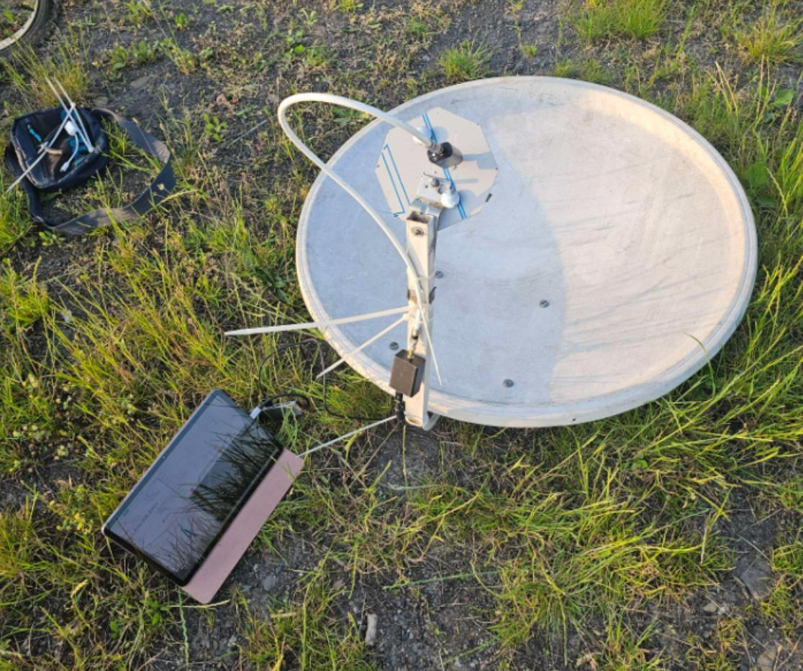 <br>
*The setup used for the final NOAA HRPT reception*

And the final image I ever received:
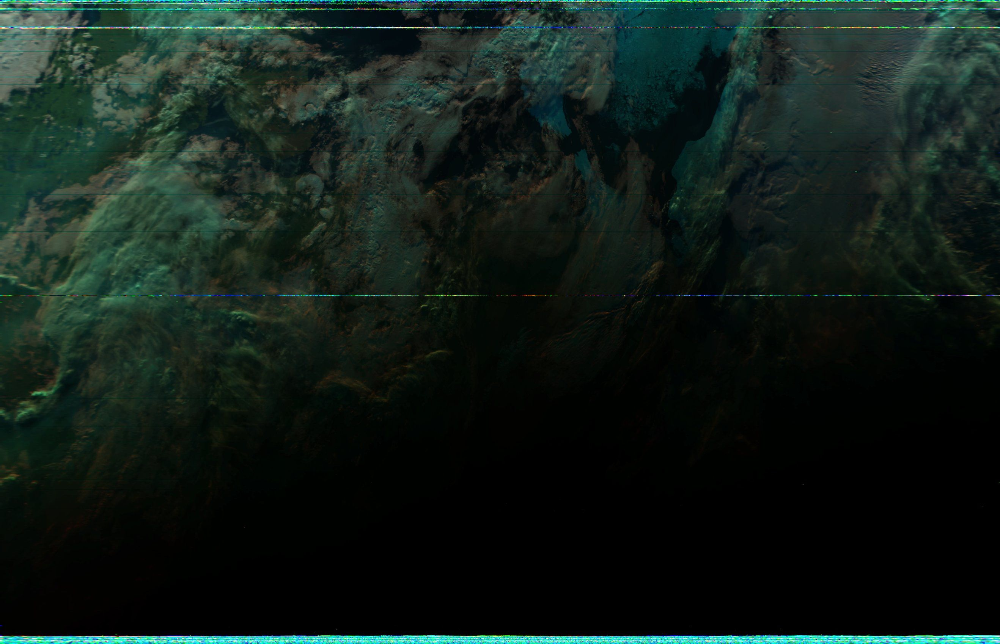 <br>
*The final sunrise that NOAA-18 got to see before the shutdown command. Received on 6/6/2025 at 17:31Z, pass ended just about a minute before the final shutdown command was issued. Processed by SatDump using the `AVHRR 3a21 False color (Uncompensated)` composite. 80% quality JPEG compression and median blur. Full resolution image and pass are both available [here](https://sat-archive.metislair.com/L-band/NOAA%20POES/NOAA-18/2025-06-06_17-31_noaa-hrpt_Meti/)*

Being the first satellite I ever managed to receive, this was a quite sentimental pass. May NOAA-18 rest in peace.


*My first image received from a satellite - NOAA 18 received on 12/10/2023. I felt it was appropriate to include it again.*


## Satellite data archive

06/2025 and onwards

I was always curious about how some broadcasts that I never got to see looked like. The best example was FengYun-3B which died in 2021, as it transmitted true color over Europe. Who WOULDN'T want to see that?!

This curiosity gradually spread to other satellite series as well - i.e. Meteor-3, GOES-N (while over the US), even specific transmissions like GOES GRB. It quickly became clear that there was no place hosting such historical data to be viewable by radio amateurs at scale, so I decided to start my own at https://sat-archive.metislair.com/

At first, it only included a few passes with sample imagery that I linked in my guide, but I later started asking around for data from others that I couldn't receive myself. Especially old data, as I started this hobby quite late in the grand scheme of things.

Over the coming months it doubled, then quadrupled, then grew to upwards of 200 GB of satellite data. Thanks to people like Les Hamilton and DD1US I managed to feature historical APT which was heavily sought after in my circles, thanks to EaL-Fvalk I managed to feature Meteosat xRIT which was basically unheard of in my circles, and thanks to several others listed [here](https://sat-archive.metislair.com/CONTRIBUTORS) I finally had a place which had tens of different satellite series and their broadcasts usable for development as well as science.

```bash
┌─[meti@server-172] - [2026-10-25 03:55:51]
└─[0] <> du -hd 1
96M     ./Extra
241G    ./X-band
199G    ./L-band
27G     ./S-band
21G     ./VHF
487G    .
```
*The current size of the archive as I am writing this sentence*

The project went on the back burner for the most part in 2026 because of a lack of motivation, however I did give it a new frontend to make it easier to navigate.

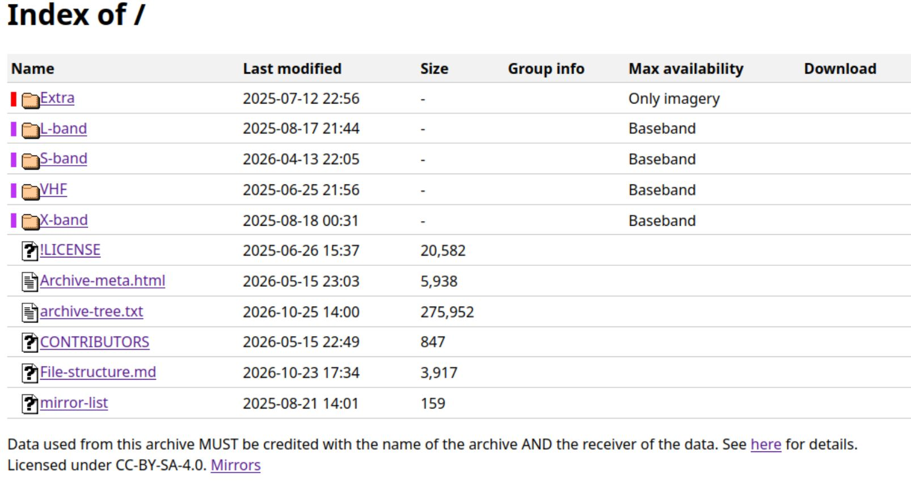 <br>
*The UI developed in late 2025, polished in early 2026*

I heavily encourage you to give it a visit if you're curious about the broadcasts and haven't received them yourself yet, I think it is quite interesting to see the data in this format (:


## Meteor MSU-MR calibration

9/6/2025

Another quickie. On this day, Meteor M2-3 performed an MSU-MR calibration. At first the community got scared thinking the upset was unintentional and a sign of the satellite losing attitude control like with Meteor M1 and M2. However, Lego calmed everyone down describing that this is normal and just the way that these satellites calibrate their imagers.

> TL;DR due to budget constraints, they have to rotate the whole satellite to point at the moon and sun in order to get a known brightness reference.

Hearing about the Meteor upset I quickly ran out with my direct reception setup and captured this image:


 <br>
*Meteor M2-3 received on 9/6/2025 at 18:50Z during an MSU-MR calibration induced upset. I've included an arrow to point the moon out for your convenience. Processed with SatDump using the `AVHRR 3a21 False Color(Uncalibrated)` composite. Compressed, median blur applied. Full resolution imagery and pass .cadu are available [here](https://sat-archive.metislair.com/L-band/Meteor-M/Meteor-M2-3/2025-06-09_18-47_meteor-hrpt_Meti/)*


## Radome for waterproof helixes

22/6/2025

I originally had big plans for the summer of 2025, as I wanted to mod two Diseqc motors to act as a 360° rotator usable for automatic L-band reception. Spoiler alert: that never went anywhere because it took me far too long to get the second motor.

HOWEVER, even though the rotator project was a dud, the other part of it wasn't! A big issue with leaving your equipment outside is waterproofing. This is especially true with a helix as the gap between the actual antenna and ground plane is tiny, any water being there cripples the performance as it effectively shorts the antenna out. 

Hence, I wanted to design something inspired by Seler1500's radome design that I could reliably produce without it leaking. So I got to creating designs with my (then) new 3D printer and transparent PETG filament:

 <br>
*A lot of scrapped prototypes because they kept leaking. It took a while to get the right settings dialed in*


 <br>
*One of the final designs*


In the end I got a design that had satisfactory results! The attenuation was just circa 0.2 dB, it was completely watertight. I'd originally planned to try to sell waterproof pre-made helixes like this, but ended up not doing so because of a lack of interest for it.


## USB incident, cont'd

8/7/2025

Near the start of July, I yet again noticed the micro USB on my Airspy was becoming 'loose'. Instead of buying new flux, I decide I was going to try something else.

 <br>
*10 USB-C ports, shipped in a very appropriate baggie*

These USB-C ports were designed with a tiny circuit board which matched the footprint of micro USB. The purpose is to solder directly in its place, effectively replacing the port with the far more reliable USB-C.

Theoretically this is a great design, and practically I'm sure it is also great if you solder it properly! However, yet again, several things piled up for me:
- I did not pre-tin the pads for some reason
- The flux I had made heating the micro USB side solder not enough for it to flow onto the USB-C pads
- I grew impatient, stopped taking proper precautions

After about an hour of attempting it, this was the result:

 <br>
*Can you tell what's wrong?*

The VCC and GND pads were nicely soldered, same with Data +, and Data -... Wait, where's the pad?

It turns out that heating the whole assembly up for far too long *does* have an effect, as I managed to rip the pad off! You can't even begin to imagine how much pain I experienced trying to fix this.

In sheer disbelief, I just gave up on the SDR for now.


## QO-100 intermission

12/7/2025

Another quickie to lighten the mood. During this time I tried to receive some stuff from QO-100. After having figured out how to power my LNB and seeing that its LO was quite stable, I had my friend transmit a couple of SSTV memes to it. I will include a couple for your enjoyment.

 <br>
*The glorious setup used to receive QO-100 on that fateful day.*

 <br>

These are from the next month, but it's the same setup and same friend. I also lost the other images received from July because of the laptop killing itself.

> 'No man steps in the same river twice, for it's not the same river and he's not the same man.' I liked this quote and thought it was cool to include as it is kinda related... somehow.


 <br>
*'Interesting'*

## Laptop note

31/7/2025

This heading is just to provide context even though it has no relation to satellite reception. On this day, my ARM laptop decided to completely kill itself by breaking UAC, CMD, PowerShell, and Windows settings. Reinstalling was not possible because of the Microsoft ARM image not having the right drivers. Naturally, installing the ones from Acer did not fix the issue as they weren't meant to be installed in the installation environment.

So this is where I started using a MacBook Air M2 instead.

## PF mount

9/8/2025

Wanting to finally fulfill my dream of having my very own L-band station, I decided to dig a pole into the ground to mount a dish on. Once settled, I DIY'd a mount onto my (originally) mount-less PF dish by drilling one from a smaller offset dish onto it.

 <br>

This worked surprisingly well, albeit the dish had to periodically be realigned. I originally pointed it at Elektro-L3, hoping to receive xRIT at some point. However, I lacked the equipment to make the station permanent for the time being.


## Patch feed 

13/8/2025

Having only used my cantenna for most satellites because of its reliability, I decided it was finally time to try making a **patch feed**. Specifically, I followed [this](http://sat.cc.ua/page3.html) design.

Requiring some super specific parts (brass screws, nuts, the circular plate itself) and a super specific diameter ground plane, it was quite annoying to get all of them. However, I managed to find almost everything needed on AliExpress and just got a chimney cover from Allegro which I then cut down to the correct height.

The feed itself came out very well:


 <br>
*1.074 SWR tune at 1692 MHz. Perfect!*

From the few tests I did on Elektro-L3, it also performed very well! I just never figured out a proper mounting solution for it, making it sit on a shelf for most of its life. The feed ended up being sold.

I definitely want to revisit this at some point, as it really isn't all that difficult to make.


## Final APT reception

18/08/2025

With the NOAA-15 decommissioning happening on this day, this would be the last APT I will have ever received. So I made sure to make it count by using my old Yagi-Uda antenna. Even after being completely mangled several times, I was still able to straighten it back to perfection and use it to receive this pass.

 <br>
*The setup used to receive it*


*The final APT image received by me from NOAA-15 on 19/8/2025 at 15:16Z using a Yagi-Uda antenna, SAW BPF+LNA 137 MHz, and Nooelec SMART SDR V5. 80% quality JPEG compression applied. Full pass including baseband is available [here](https://sat-archive.metislair.com/VHF/NOAA%20POES/APT/NOAA-15/2025-08-19_15-16_noaa-apt_Meti/)*

As it turns out this decommissioning failed with the satellite restarting during the following orbit, meaning I could have caught some empty APT in the next few orbits. However, I didn't expect it, so I didn't try. By the time the community learned of this, the satellite was already double-tapped by NOAA.

## Vadim 

22/8/2025 - 10/2025

After some talks with Lego, he came to the proposal that I could make a station to feed a frontend UI with up-to-date satellite imagery. The goal was to hopefully do this more reliably than EuMetCast UIs (which is a VERY low bar to beat). On the 22nd, I did some tests to find the right skew. This had me bend the mount slightly because I was not about to drill move mounting holes into the feed (it uses the thick & heavy cantenna).

You might be asking yourself: "Why call it 'Vadim'?". Well, at that time the station was meant to receive Elektro HRIT, we had an inside joke about the Roscosmos operative who starts the xRIT transmissions being called 'Vadim' and constantly falling asleep as the transmissions kept being a few minutes late or skipped altogether. Riveting backstory, I know.

The tests went *fairly* well - using the G4DDK VLNA I got up to 4.5 dB on HRIT. I did some more tests 6/9/2025 through to the 27th figuring out best skew, positioning, coaxial and USB runs for best noise performance.

For waterproofing, I just placed the setup on a few cinder blocks and covered it in  a bucket. For insect proofing, I placed the bucket on a window net then taped the edges shut.

 <br>

As redneck as it looks, it worked fine! And it held up surprisingly long - I only replaced it after a whole year to make it more reliable in all weather conditions.

---


I kept receiving Elektro xRIT until just 29/9/2025, when my worst fears were confirmed - the heat from the sun was raising the noise floor enough to be causing me drops in the imagery. I faced this several times in the weeks prior, but I hoped the improved coax & USB runs fixed it. They didn't.

The lack of reliability made me reconsider the viability of this station, when I thought of FengYun-2H. Thanks to work me & Alan did on the decoder, it was now significantly more reliable at low SNRs - the calibration data came in cleanly even as low as 2 dB! As I could easily get S-VISSR at up to 13 dB at this time, giving me a margin of almost 11 dB. This big of a margin would allow reliable imagery 24/7 regardless of how bad the conditions got.

So I made the switch. From October, Vadim was set to receive S-VISSR. Since then, more than 500 GB of data has been received.

 <br>
*FengYun-2H S-VISSR received by Vadim on 9/7/2026 at 06:00Z. Processed with SatDump using the `False color` composite. Compressed, resized to 50%. Raw data available [here](https://vadim.metislair.com/IMAGE/2026-07-09_06-00/)*

I also have a few timelapses available [here](https://vadim.metislair.com/timelapses/) if curious.

## Fishballin'

27/10/2025

After having gone on hiatus for a bit to focus on school, I decided to order a **Zynq7020-based HamGeek SDR** nicknamed 'Fishball' by the community. I did this, because I thought it was an apt time to finally start working on getting an X-band setup going. Looking at the `Complete order` button I had a lot of second thoughts, knowing how expensive X could get. But I pushed on.


That was a week or two ago. Now, I had a neat little SDR with a big limitation - **it had no case** because this model wasn't sold with one. I originally intended to use it without one, but after an *incident*, I reconsidered this choice.


 <br>
*A broken-off transformer on the TX2 port. Oops*

So a case was needed, but none existed online. What to do? Well, I decided it would be nice to learn a new skill - 3D design!

So I got to work making prototype after prototype of a case for this SDR to hopefully prevent any more impacts. I ended up going through *several* iterations:

 <br>


In the end, I settled on a design which both covered the brittle transformers but also offered protection for the SD card against bending. Given the SDR came with a fan, I designed around it and included a neat little heat exhaust.

 <br>
*The final version of the case*

I made the design available for download [here](https://www.thingiverse.com/thing:7207664/files). 


> Making this design was a lot of fun! Especially since I had to waste a LOT of time in IT class teaching basic python for the 4th time...


## X-band equipment tests

11/2025 - 12/2025

Throughout November, I started collecting all the equipment necessary for X band reception. In total:

- 07/11/2025 - I bought a Waveguide from Maresz
- 21/11/2025 - I bought a LNA from Digitelektro
- 28/11/2025 - I borrowed a SatDump branded downconverter from Lego

This made the gang complete:


Oops, wrong gang. I meant this one:

 <br>
*Way too much money is in this picture. BUT IT'S WORTH IT*

---

Too impatient to wait for my next cottage trip (just a few days later), I made a quick setup on my balcony to test for any immediately obvious issues.

 <br>
*Excuse the mess, I was honestly super excited to try it out*

Under Lego's guidance, I learned, that the Elektro-L2 RDAS should be plenty strong enough to be receivable with just the feed by itself.

So I held the feed out, and... Okay, I see a carrier, but pointing it the other way still has it visible. Is it just a spur? Or maybe some interfere-

 <br>
*Elektro-L2 RDAS switching from carrier to filler on 04/12/2025 at 20:59Z*

It switched to filler!!! That was the definitive proof needed, that all parts of the X setup worked fine. The carrier is so strong, that it bounced off of surfaces and was visible wherever I pointed the feed. Fascinating!

So I had a working setup, but no champagne could be poured yet, as I hadn't received any imagery yet. That would come a few days later.


## First X-band images

5/12/2025

On this day I went to my cottage, whipped out an 80 cm dish, and got to work. Being winter, it was already dark at that time. I mounted everything up, got ready to make my first reception.

 <br>
*The setup before I realized I could just feed 12V straight into the LNA without the 5V regulator*

Starting with Syracuse telemetry, the benchmark X-band satellite, I immediately noticed something was wrong - the performance I was getting at WAY below expectations. Was my setup that bad? Was the dish bent? Did I blow a stage in the LNA?

 <br>
*SatDump demodulating Syracuse-3B telemetry at a measly 5.7 dB. For an 80 cm dish, at least 15 dB was expected.*

The first thing I checked was the Teflon depolarizer - a little piece of plastic wedged in the feed to make the feed circular rather than linear. After having taken the cover off:

 <br>
*Ah, that'd do it. The little white square is supposed to be almost completely inside the feed, it had fallen out.*

Having pushed the depolarizer back in, I checked Syracuse telemetry again. It showed 8 dB. An improvement! But still WAY below expectations. Having heard about L2 RDAS being incredibly strong, I gave that a quick test, giving me my first X-band image:


*Elektro-L2 RDAS channel 1 received on 5/12/2025 at 19:07Z by yours truly using an 80 cm offset dish, waveguide feed, Digitelektro X-band LNA, SatDump v2 LNC (prototype), HamGeek Zynq7020. Compressed. Full resolution image available [here](https://static.metislair.com/Three-years-of-satrx-assets/first-x-pic_L2_05-12-2025_17-00z_ch1.png)*

Seeing as I was getting a measly 5 dB, I only let the reception run for a few seconds before ending it.


Checking Look4sat, I saw FengYun-3G was about to pass, so I jumped on that opportunity, even with my (then) crap setup.

Being known for its ridiculously strong signal, I managed to catch it at a surprisingly decent 11 dB. This was plenty to get me my second X-band image:


*FengYun-3G AHRPT received on 5/12/2025 at 19:07Z 80 cm offset dish, waveguide feed, Digitelektro X-band LNA, SatDump v2 LNC (prototype), HamGeek Zynq7020. 90% quality JPEG compression applied, resized  to 25%. Processed with SatDump using the `AVHRR 543b` composite, rotated 270°, individually equalized, map overlay added. Full resolution image and pass .cadu are available [here](https://sat-archive.metislair.com/X-band/FengYun-3/AHRPT/FengYun-3G/2025-12-05_19-07_fengyun3-g-ahrpt_Meti/)*

Surprisingly good image! FengYun-3G's orbit makes it incredibly fast, tracking X-band for my first time was **humbling**. Choosing 3G didn't do that any wonders either!

---

Seeing no further passes for a bit, I returned to Syracuse. Why was it so weak? Maybe I had some interference on the donwoncverted frequency? Thankfully, the SatDump LNC had variable LO settings - so I got to testing.

5500 MHz, still garbage. 5800, nope. 6200, slight improvement - 10 dB. Am I on the right track?

6500 MHz, 16.5 dB. The dish was finally performing well!!! As it turns out, on my setup, the 1200 MHz IF works the best - Syracuse being at 7725 MHz, the 6500 MHz LO produced the optimal 1225 MHz. I immediately rushed to get the next Elektro-L2 image, while I missed the VIS channels, I managed to get clean IR as the SNR was a glorious 11 dB!

 <br>
*Elektro-L2 RDAS channel 4 received on 5/12/2025 at 22:00Z using an 80 cm offset dish, waveguide feed, Digitelektro X-band LNA, SatDump v2 LNC (prototype), HamGeek Zynq7020. 85% JPEG compression applied. Full resolution image available [here](https://static.metislair.com/Three-years-of-satrx-assets/third-x-pic_L2_05-12-2025_22-00z_ch4.png)*


## X-band Euphoria

12/2025 - 1/2026

Finally having a fully working X-band setup, I was receiving as much as possible, as often as possible. I log circa 80 receptions just 06/12 - 31/12!

I won't include full resolution links for a lot of X stuff, as I am not at home and *the raw image is a gigabyte in size*. Sorry!

 <br>
*FengYun-3F AHRPT received on 31/12/2025 at 10:20Z using a 130 cm offset dish, waveguide feed, Digitelektro X-band LNA, SatDump v2 LNC (prototype), HamGeek Zynq7020. Processed with Satdump using the `True color` composite, individually equalized.*


## NYE Snow storm

30/12/2025 

A quickie, on New Year's Eve 2026, a freak snow storm occurred in Eastern Slovakia. A pass from the 30th captured it very well:


*FengYun-3D AHRPT received on 30/12/2025 at 13:53Z using a 130 cm offset dish, waveguide feed, Digitelektro X-band LNA, SatDump v2 LNC (prototype), HamGeek Zynq7020. Processed with Satdump using the `True color` composite, individually equalized.*

A closer crop:

*Same image as above, just cropped to Eastern Europe. Full resolution available [here](https://static.metislair.com/Three-years-of-satrx-assets/fy3d_30-12-2025_13-53_tc-crop.png)*

# 2026

Finally, we're in the current year. Not long to go!

Having gotten an X-band setup going, I focused on perfecting its performance as well as just generally just getting as many passes as I could.

## LibreSDR B210

28/2/2026

Being a bit irked with the limited bandwidth of my HamGeek SDR (The most I could pull off was 49 Msps), I considered new alternatives. The best one was unequivocally the LibreSDR B210 - €200 for an SDR which can do 64 Msps natively, up to 122 Msps with modified firmware. I ordered it a few weeks earlier, it got stuck at the border for a while, then it finally arrived on this day.

Just days prior, Mothmaux managed to release the firmware mod that allowed 122 Msps like with the BladeRFs - I immediately jumped on it, following Seler1500's guide to perform the mod on SatDump. A bit of effort later, it worked perfectly!  


*Metop-SGA1 DB received on 1/3/2026 at 09:57Z using a 130 cm offset dish, waveguide feed, Digitelektro X-band LNA, SatDump v2 LNC (prototype), LibreSDR B210. Processed with Satdump using the `True color` composite, individually equalized. 80% quality JPEG compression applied, resized to 12.5%. Full resolution image as well as complete pass are available [here](https://sat-archive.metislair.com/X-band/MetOp-SG/DB/MetOp-SGA1/2026-03-01_09-57_metopsg-db_Meti/)*

MetOp-SG has a data rate of 93.3 Msym/s, meaning I wasn't able to receive it without the mod working well. Even though the satellite sucks (the striping is horrible on all infrared channels), it is cool that I am able to receive it at all (:

## Geostationary moon intermission

4/3/2026 - 5/3/2026

Another quickie. During these days, the moon passed behind the Earth at perfect times to be imaged by geostationary satellites. I managed to capture it on two satellites within one day of one another:

First, FengYun-2H S-VISSR 
 <br>
*FengYun-2H S-VISSR received on 4/3/2026 at 08:00Z by my automatic station, Vadim. Compressed.*

And second, Elektro-L2 RDAS

 <br>
*Elektro-L2 RDAS received on 5/3/2026 at 14:00Z using a 130 cm offset dish, waveguide feed, Digitelektro X-band LNA, SatDump v2 LNC (prototype), LibreSDR B210. Image pulled from my Discord post, as I've sadly misplaced the original file.*

## Aurora chasing

7/3/2026

I'm not gonna lie, this is the part of the post I was the most excited to write about. JPSS satellites feature a panchromatic scanner capable of night imaging, which is part of why I consider them my favorite series of all (NOAA-21 is by far my favorite). As other sun-synchronous-orbiting satellites, they have two pass groups per day, one just before noon and one just after midnight. Up until this point I always focused on receiving the noon ones, because who would be crazy enough to go out to receive satellites in a field from 00:00-03:00?

So I went out at 00:00 to start the reception series, receiving 4 passes in total:
- 3x NOAA-21
- 1x Suomi NPP

The SNPP pass was unplanned - I was originally set to only receive the 3 passes of NOAA-21 at that time since they were all passing relatively close to one another, but the first pass turned out quite poor as it was just a few degrees above the horizon and clipped several trees. After checking Look4sat, I noticed that Suomi NPP had a slightly higher pass just afterwards, so I decided to give it a shot as well.

Honestly, it pleasantly surprised me! Every prior SNPP reception went horribly because of the antenna nulls, but this one turned out completely fine say for one drop. Good job, little king!

The best pass of the day was the third and last NOAA-21:


*NOAA-21 received on 7/3/2026 at 01:39Z using a 130 cm offset dish, waveguide feed, Digitelektro X-band LNA, SatDump v2 LNC (prototype), LibreSDR B210. Processed using SatDump with the `DNB Night` composite, border overlay added. 90% quality JPEG compression applied, resized to 25%. Full resolution image is available [here](https://static.metislair.com/Three-years-of-satrx-assets/N21_aurora_07-03-2026_DNB.png). Full pass is available [here](https://sat-archive.metislair.com/X-band/NOAA-JPSS/NOAA-21/2026-03-07_01-39_jpss-2-hrd_Meti/).*

It easily took the cake for my all-time favorite satellite image I ever received. 

A projection of all of that evening's passes:

 <br>
*NOAA-21 received on 6/3/2026 at 23:58Z and 7/3/2026 at 01:39Z, Suomi-NPP received on 6/3/2026 at 22:48Z. All received using a 130 cm offset dish, waveguide feed, Digitelektro X-band LNA, SatDump v2 LNC (prototype), LibreSDR B210. All processed using SatDump with the `DNB Night` composite. Border overlay added. Compressed.*


It was a great night, I will definitely be trying something like this again in the future.


## LNA issues solved

2/4/2026

This is something I've neglected to mention until now. Ever since starting out with X, I've experienced an issue with my LNA. Tightening the SMA between it and the feed made it oscillate seemingly at random. I just got used to it thinking it's normal, but later - in March - it got so bad to the point where I couldn't really receive any passes without the LNA starting to oscillate. It was super annoying!

I tried replacing the SMA bracket I used, but it made no change. At the end of my wits I approached Digitelektro to see if he had any ideas, he suggested I send the LNA and feed to him for testing.

I did so, it turned out the first stage of the LNA was acting weird, and that the SMA on the feed wasn't of very good quality. After he replaced both (Very grateful for that!), everything started to work fine. Finally, I could receive stuff reliably again. Hooray! 

> Maresz was, of course, made aware of this. He promptly stopped using the brand of SMA connectorsô

 <br>
*The oscillations in question. Trippy!*

## MacBook Meltdown

5/2026

With summer quickly approaching, the MacBook Air's fan-less design was quickly catching up to bite me in my arse. With temperatures rising and the temperatures in sunlight passing 40 °C, the laptop started heating up to the point where I actually got burnt touching it. The stupid design made me stop going out for RXes when it was sunny, because it was flat out impossible to process the data afterwards!

Knowing I was going to do a lot more satrx before the end of summer and that the 512 GB wouldn't get me far in uni, I decided it was time to replace the MacBook. A shame, really - I liked a lot of aspects about the laptop. I have a full review available [here]({{site.baseurl}}/docs/A measured MacBook Air review.html)

To replace it, I bought a ThinkPad E14 G7 with a Lunar Lake CPU from Intel - honestly a fantastic purchase which I haven't regretted one bit. Except for one tiny aspect: the SSD. I'll get into that can of worms shortly.

## S-band grand finale

06/2026

My friend, Seler1500, sent me their LNAs to test S-band with in this month. As I already had a B210 SDR capable of natively receiving 2.2 GHz, I could use a direct amplifier setup without any downconversion. I specifically asked her to send a version with two SAW filters hoping to cut off as much noise as possible (as S-band was very noisy where I live).

After testing S-band with what I knew to be half-decent LNAs (from others' tests), I finally ruled out crappy MMDS receivers being the reason my S-band has sucked. As it turns out, my QTH is simply crap. There is too much LTE noise everywhere, completely drowning any weak satellite signals out below a 20° elevation. For once, it wasn't my craftsmanship being at fault. *Woo*

> S might be unusable but **at least my L spectrum is clean!**


## SSD fiasco

06/2026

When buying a laptop, I was offered 2 TB for €90. IN THIS ECONOMY, I couldn't NOT end up buying it! I overlooked one tiny but important detail though: **it was QLC and not TLC**. 

Now if you aren't into computers, those two terms are just gobbledygook. You don't have to understand the meaning behind them; just the implications:
- **QLC** SSDs are often cheaper and offer great read/write speeds, but only in bursts! Once their cache fills up they slow down to a CRAWL.
- **TLC** SSDs are often more expensive but offer reliable read/write speeds even on long writes.

Now, I initially didn't notice anything, because it was brand new - it behaved almost exactly like a TLC SSD would. I received up to 122 Msps on it without problems, until a sudden turning point came. In mid-June, I started dropping samples. **Hard.** I couldn't even record at 20 Msps for longer than a few minutes without it dropping like hell, making the recordings useless.

After some investigation, I found the speeds to randomly drop to just 30 MB/s. A far cry from Crucial's 3 GB/s claims!!! Sadly, this is just a limitation of the SSD technology and is not something solvable by say TRIMming the SSD (A command which clears all unused blocks, which should make it 'like' brand new. Because of some QLC magic, it doesn't.) 

I haven't had much time to find other solutions; so I just went with the simplest one. I started using my desktop's old TLC SSD in an M.2 enclosure, which still isn't perfect as it drops due to too much data flowing through the USB controller, but it drops consistently and low enough for the oversampling to be able to deal with it for the most part. However, it means I can not record 122 Msps anymore without significant drops. This sucks, but was good enough for me before I managed to buy a TLC SSD.

## Friedrichshafen Ham Fest 2026

25/6/2026-28/6/2026

This was my first time attending a conference of any kind, I can't put into words how amazing of a time I had.

The group I went with was full of incredible people who were a blast to be around, with the event being full of interesting things to check out. I can safely say it was the best week of my life thanks to you guys <3

Some photos I took:


*The SatDump booth at FDH 2026*

 <br>
*The flea market*

 <br>
*I even got to use a working, original Enigma machine. So cool!*

## HA5KFU

21/7/2026

Having one day left on my Interrail ticket from FDH, I decided I would use it to go visit my friends over at HA5KFU in Budapest. I brought my X-band setup with me to let them try the tracking out for fun as well (:

Given that I was only in Budapest for a limited amount of time, we used it to the fullest extent. I was shown around the very cool club space, then we got to checking dishes. As it turns out, focal *points* should be renamed to focal **lines** on some of these.

After finding a dish which wasn't bent, we managed to mount my X band waveguide onto it (not before a blood sacrifice from HA5PLS while sawing the old, rusted screws off), and tried to receive a few passes. 

Aqua was passing first, given its strength I let HA5PLS give it a shot.

> NOAA-21 also passed but was too weak for a good decode

 <br>
*HA5PLS tracking Aqua.*

 <br>
*Aqua tracked by HA5PLS from HA5KFU on 21/7/2026 at 14Z using a 90 cm PF dish, Waveguide feed, Digitelkektro X-band LNA, SatDump LNC V2 (Prototype), LibreSDR B210. Processed with SatDump using the `True color` composite. Compressed.*

Out of curiosity, I asked HA5PLS for a quote on how difficult tracking Aqua was:
> "I don't really have a base of reference, but what I found most difficult is that one could have a false sense of 'I got it' since the signal was so strong, but it needed a stupid amount of SNR (which it was capable of outputting BTW) because of the RS... It's not that the link was weak, it's just that it was hard to tell when I was locked on or not"

I then hopped onto tracking FengYun-3D myself to give them a nice thumbnail image, as well as to show the tracking strategies X band employs.


 <br>
*FengYun-3D tracked by yours truly from HA5KFU on 21/7/2026 at 14Z using a 90 cm PF dish, Waveguide feed, Digitelkektro X-band LNA, SatDump LNC V2 (Prototype), LibreSDR B210. Processed with SatDump using the `True color` composite. Compressed.*

All passes received here are available in full quality here: https://static.metislair.com/ha5kfu/


I sadly had to leave before we could receive any more passes. I'll definitely come back some time!


## Improved direct reception helix

09/2026

Having moved to the Netherlands in August, I had to start from scratch and with limited space - this means *no dish*. This forced me to revisit the idea of using a direct reception helix, albeit with a design constraint.

I will keep this brief as I already have a full write-up available [here]({{site.baseurl}}/docs/Radio/Improving the direct reception helix.html).

My original design was just carried in a tote bag, as I had to only walk about 250 m to get to a local field. This time around, I had to cycle 20 minutes to get to a suitable RX spot. Tote bags are cool and all, but I wanted to be able to carry it in a backpack.

To do this, I had to make the design "modular" - make the long helix detach from the wide and flat ground plane. I did this by using two separate ground planes held together by the scaffold's mounting screws.


This design proved itself by providing me excellent results:

 <br>
*Meteor M2-3 HRPT received at 8:31 UTC on 27-09-2026 using the direct reception helix pictured above with a SawBird GOES+ and a LibreSDR B210 Mini. Processed with SatDump using the `AVHRR 3a21` composite. Lossy JPEG-compression applied at 25% original resolution. Full-resolution JPEG can be found [here](../../assets/images/Improved-helix/Meteor-M2-3_08-31_27-09-2026_AVHRR3a21.jpg)*

It is currently my primary way of receiving L-band satellites. I am looking into buying a dish and modifying it to be mountable on my bike rack. That is still TBD though.


# Future

So, we've reached the end. As corny as it might be, I want to be honest here. I am really glad I got to sit down and write this when I did.

Because of some recent actions by certain individuals as wel as general trends in tech, the future of this hobby is the most uncertain it's ever been. The places I used to enjoy staying in have become barren, toxic, or a sad mix of both. It's gotten quite bad as of late.

I considered quitting at several points, because why bother when everything around you is so negative? It felt like that is how the hobby is going to be going forward, which is a very depressing thought.

As a friend once put it, it is easy to see all the bad and miss all the good. You tend to look over good happenings because they fade into the background, whereas the stuff that stings ends up sticking. Because of said recent actions, I grew a huge distaste for the hobby as I felt like it was incredibly negative and just hurting me as a person. Writing everything out in here has made me realize just how much good there's actually been, and honestly restored the faith I needed to continue.

Even though the future is uncertain, I am incredibly grateful for the 3 years I got to spend doing this hobby. Nothing can take away these years of fun memories and experiences away. Even though some parts of this hobby may be lost to time and some people might not be around anymore, it doesn't mean that I shall stop enjoying it. At the end of the day this is still a fun pastime of mine which I still do and will keep seeing the fun in. I wholeheartedly thank everyone who has made that possible (: 

Here's to another year of fun.

> "Dance through the darkness" <br>
> \~ Jack Abbot, *The Pitt*


# Epilogue

I hope I didn't tire you out after this much rambling. Whether you read this out of curiosity or shared interests, I hope you took something away - this hobby is full of so many possible things to do; You can always find something to play around with. I hope you enjoyed, and will see you in a year (:

> *(Or two and a half years, depending on Saturn's orientation and blood moon cycle.)*

 <br>
*The very aesthetically pleasing spot where I finished this post up. In total, it took about 25 hours of work.*

If you have any questions or remarks, feel free to forward them to me on Twitter (@Meti172172) or on Discord (@Meti172).

o7